# Cognitrade 基金策略回测手册

> 适用基线：`origin/main` `139ef11c00ed9605c49e82760c240e26cb685fa1`
> 核对日期：2026-08-14
> 当前产品入口：`/strategies`
> 当前 API 根路径：`/api/v2/finance`

## 1. 手册范围

本手册说明当前 Cognitrade 中“基金日报复合策略”的完整回测流程，覆盖：

- 策略草稿、发布版本与基金绑定；
- 历史日报、点时（point-in-time）证据与四态交易信号；
- 以 `fund_only` 为默认主线，必要时使用高级 `holdings_portfolio` 穿透模拟；
- Hikyuu 技术信号、确定性交易账本、费用与 T+1 约束；
- 回测预检、异步运行、结果解读、重试和取消；
- 确定性复跑、机器验证、人工确认和模拟盘晋级；
- Web 操作、API 调用、故障定位与验收清单。

当前只有 `/api/v2/finance/strategy-backtests/**` 一套公开回测接口。旧的单股票自由参数诊断接口和旧前端 `/backtesting`、`/methodology` 已退出产品入口；历史结果文件保留只读，不会混入基金回测记录。

## 2. 先理解完整链路

```mermaid
flowchart LR
    A["系统模板 / 策略草稿"] --> B["保存草稿"]
    B --> C["发布不可变 StrategyVersion"]
    C --> D["创建基金 Assignment"]
    D --> E["按交易日生成 DailyReportSet"]
    E --> F["生成基金与持仓 TradeSignal"]
    F --> G["Backtest Preflight"]
    G --> H["Hikyuu MA 技术信号"]
    H --> I["确定性 Ledger 执行"]
    I --> J["内容寻址 Backtest Result"]
    J --> K["同输入确定性复跑"]
    K --> L["机器 Verification"]
    L --> M["人工确认 Verified"]
    M --> N["Promote 到模拟盘"]
```



回测不是直接把“基金代码 + 均线参数”交给 Hikyuu。真正的输入由三层组成：

1. **已发布策略版本**：冻结评分权重、阈值、质量门、均线、费用、模型与方法论 pin。
2. **历史日报和交易信号**：每个交易日只能使用当时可获得、可追溯的报告证据。
3. **市场行情**：按回测截止时点拉取并记录内容哈希，供重放和审计。

Hikyuu 只负责固定的技术核心；资金、费用、仓位、T+1、信号门控和 lineage 由 Cognitrade 的确定性账本负责。

## 3. 核心对象和状态

| 对象 | 作用 | 关键性质 |
|---|---|---|
| Strategy | 用户可编辑的策略容器 | 有草稿修订号，可归档 |
| StrategyVersion | 一次发布快照 | 文档和 `content_hash` 不可变 |
| Assignment | 策略与基金、模式的绑定 | 只能引用已发布策略，可暂停或恢复 |
| DailyReportSet | 某基金某交易日的日报集合 | `final`、`final_partial` 或 `blocked` |
| TradeSignal | 基金或持仓股票的交易门控 | `ALLOW_BUY`、`WATCH`、`AVOID`、`BLOCKED` |
| BacktestRun | 一次异步回测 | `queued`、`running`、`completed`、`failed`、`cancelled` |
| StrategyVerification | 回测的机器检查记录 | 机器通过后仍需人工确认 |
| PaperStrategyBinding | 模拟盘主策略绑定 | 同账户、基金、模式仅一个 Promoted 主策略 |

### 3.1 四态信号

| 信号 | 含义 | 回测中的行为 |
|---|---|---|
| `ALLOW_BUY` | 研究和质量门允许增加风险 | 仍需技术条件满足，才可买入或加仓 |
| `WATCH` | 证据不足以买入，也没有明确回避 | 不新增仓位；不会因为数据缺失而强制卖出 |
| `AVOID` | 明确回避 | 可触发减仓或清仓 |
| `BLOCKED` | point-in-time、coverage、critical 或 lineage 门禁未通过 | 不允许新增仓位；不能伪装为中性或买入信号 |

当某交易日报告缺失时，策略最多沿用之前的信号 `missing_report_carry_days` 个交易日，且保留原信号 lineage；超过期限后转为 `BLOCKED`。

## 4. 五分钟快速开始

适合第一次验证整条链路：

1. 部署并执行运行时检查：`./scripts/deploy.sh runtime-check`。
2. 打开 `http://127.0.0.1:8080/strategies`。
3. 从系统模板“权益基金日报复合策略 V1”复制一个个人策略。
4. 修改策略后先“保存草稿”，再“发布版本”。
5. 在“基金绑定”中选择基金和模式，创建 Assignment。
6. 在“信号预览”中为目标日期或日期区间生成日报；长区间按不超过 60 个交易日拆分。
7. 确认日报完成，并检查基金信号与持仓信号是否生成。
8. 在“基金回测”中选择已发布版本、基金、模式、日期和初始资金。
9. 先执行预检；必要时补跑缺失日报。
10. 启动回测，等待状态变为 `completed`，再检查指标、交易和 lineage。
11. 用完全相同的输入再运行一次，随后在“方法论治理”中执行机器验证、人工确认和晋级。

建议第一次采用：

- 日期范围：20 至 60 个交易日；
- 初始资金：1,000,000 元；
- 报告策略：`require_complete`；
- 默认只跑 `fund_only`；只有需要研究披露持仓的静态穿透表现时，才额外跑 `holdings_portfolio`；
- 基准：模式默认；
- 不要为了“让回测跑通”关闭 point-in-time 或 quality gate——当前公开契约也不允许这样做。

## 5. 环境和部署前置条件

### 5.1 部署检查

```bash
./scripts/deploy.sh runtime-check
./scripts/deploy.sh status
./scripts/deploy.sh token
```

`runtime-check` 应确认：

- API 和数据库可用；
- Alembic 迁移已执行；
- `hikyuu==2.8.1` 可导入；
- 浏览器和研究链依赖可用；
- 内容寻址对象存储可写；
- 模拟交易和回测相关运行时依赖完整。

升级最新版后应先执行：

```bash
./scripts/deploy.sh migrate
./scripts/deploy.sh restart
./scripts/deploy.sh runtime-check
```

### 5.2 关键配置

| 环境变量 | 用途 | Compose 默认值 |
|---|---|---|
| `COGNITRADE_DATABASE_URL` | 策略、报告、信号、回测元数据数据库 | `sqlite:////app/workspace/cognitrade.sqlite3` |
| `COGNITRADE_DATABASE_AUTO_BOOTSTRAP` | 是否自动建表；生产应关闭并使用迁移 | `false` |
| `COGNITRADE_OBJECT_STORE_ROOT` | 回测结果和不可变对象存储根目录 | `/app/workspace/strategy_objects` |
| `COGNITRADE_API_TOKEN` | API Bearer Token | 由部署配置提供 |

生产建议使用 PostgreSQL，并持久化数据库、workspace 和对象存储目录。回测结果 JSON 采用内容寻址保存；只备份数据库而不备份对象存储，会留下无法读取的结果 URI。

## 6. 支持的基金与两种模式

策略模板默认声明支持：股票型、偏股混合型、A 股指数型、ETF、ETF 联接、LOF 和可穿透 FOF。实际能否运行，还取决于 Instrument Resolver 能否把基金解析成可交易的交易所基金或有历史净值的场外基金。

包含债券、货币、商品、黄金、QDII、海外等标记的基金目前不在 v1 权益基金回测支持范围内。ETF 联接通常按场外基金处理，除非目标代码本身能解析为真实交易所基金。

### 6.1 模式对比

| 项目 | `fund_only` 基金本体 | `holdings_portfolio` 持仓组合 |
|---|---|---|
| 交易标的 | 基金份额或交易所基金 | 基金披露持仓中的股票 |
| 总门禁 | 基金信号 | 基金信号 |
| 子门禁 | 无 | 每只股票还需要独立持仓信号 |
| 技术信号 | 基金行情上的 MA(5,20) | 每只持仓股票各自 MA(5,20) |
| 目标仓位 | 基金是否持有 | 披露权重、单票上限、漂移阈值共同决定 |
| 默认基准 | 基金买入持有 + 可识别类别指数 | 期初披露权重静态组合 + 沪深 300 |
| 主要额外风险 | OTC 净值、开放状态和确认日 | 披露生效日、持仓信号和个股行情完整性 |

## 7. 策略版本到底冻结了什么

回测请求不能临时覆盖策略核心参数。下面这些内容在发布版本中冻结并参与 `content_hash`：

### 7.1 报告输入

| 参数 | 默认值 |
|---|---:|
| 持仓 UZI 分析必需 | `true` |
| 研究强度 | `deep` |
| 分析前 N 大持仓 | 10，可设 5–20 |
| 独立持仓信号 | `true` |
| 启用模式 | 两种模式均启用 |

### 7.2 基金复合分数

| 模块 | 默认权重 |
|---|---:|
| 基金表现与风险 | 40% |
| 持仓股票质量 | 40% |
| 持仓结构质量 | 20% |

三个模块权重之和必须等于 1。缺失模块不会把权重自动分配给其他模块；否则同一策略在不同数据条件下会偷偷改变含义。

基金表现与风险的默认子因子为：

- 近一年收益 20%；
- 成立以来年化收益 15%；
- 近一年基准超额 15%；
- 最大回撤 20%；
- 波动率 15%；
- 费用 5%；
- 收益一致性 10%。

持仓股票质量目前使用 `uzi_overall_score`；持仓结构质量由持仓数量覆盖、权重覆盖、披露新鲜度、集中风险、穿透完整性和不支持资产权重构成。

### 7.3 信号和质量门

| 参数 | 默认值 |
|---|---:|
| 买入阈值 | 70 |
| 观察阈值 | 55 |
| 最低置信度 | 0.65 |
| 缺日报信号沿用 | 3 个交易日 |
| 正常 coverage | 0.80 |
| 最低 coverage | 0.60 |
| 持仓披露最大陈旧天数 | 120 天 |
| 必须 `report_allowed` | 是 |
| 必须无 critical issue | 是 |
| 必须证券匹配 | 是 |
| point-in-time 必需 | 是，且不可关闭 |

### 7.4 技术与执行规则

| 参数 | 默认值 |
|---|---:|
| 技术规则 | `ma_cross` |
| 快均线 | 5 |
| 慢均线 | 20 |
| 单只股票仓位上限 | 20% |
| 再平衡漂移阈值 | 2 个百分点 |
| 场外基金最大仓位（兼容默认） | 100% |
| 场外基金单次建仓比例（兼容默认） | 100% |
| 场外基金最大建仓次数（兼容默认） | 1 次 |
| 场外基金建仓间隔（兼容默认） | 0 个估值日 |

新增的四个场外基金字段属于不可变策略版本。兼容默认用于保证旧版本仍按“一次全仓”回放；新策略可从“最大仓位 60%、单批 20%、最多 3 次、间隔 1 个估值日”开始评估，但这只是风险控制示例，不是收益承诺。

每一批都按下单日账户权益计算，并取“可用现金、单批预算、剩余仓位容量”三者最小值。后续批次会重新检查当日最新基金总门禁；`WATCH/BLOCKED` 暂停补仓，只有 `ALLOW_BUY` 才继续。

### 7.5 费用与结算

交易所股票：100 股一手，佣金率 0.025%，最低 5 元；卖出印花税 0.05%；过户费 0.001%；T+1。

交易所基金：100 份一手，佣金率 0.025%，最低 5 元；T+1；当前 adapter 不计股票印花税和过户费。

场外基金默认回退模型：申购费 0.15%，赎回费 0.5%，申购确认 1 日、赎回确认 2 日。历史申购/赎回开放状态缺失时，当前兼容策略按开放估算并在结果中逐次记录 `open_status_assumptions`；显式设置 `missing_open_status_policy=block` 才会拒绝执行。回退费用和开放状态假设均不应与销售渠道真实规则混淆。

## 8. Web 页面完整操作

### 8.1 复制和编辑策略

1. 进入 `/strategies`。
2. 在“规则编辑”中选择系统模板。
3. 系统模板只读，先点击复制，创建个人策略。
4. 调整描述、权重、阈值、均线、费用或调度设置。
5. 点击“保存草稿”。草稿采用 revision 和 ETag 防止并发覆盖。
6. 确认无未保存修改后点击“发布版本”。

发布后版本不可修改。继续改动会形成新的草稿，并在下一次发布时产生新的版本与内容哈希。历史回测永远引用原来的版本 ID 和哈希。

### 8.2 创建基金绑定

在“基金绑定”中填写：

- 策略；
- 基金代码和可选名称；
- `fund_only` 或 `holdings_portfolio`；
- 是否启用；
- 可选调度。

Assignment 不能覆盖策略规则。要改阈值、均线或费用，必须发布新版本。已有 Assignment 在后续交易日切换到新版本，不会反向改写历史日报或历史回测。

### 8.3 生成日报和信号

在“信号预览”中：

1. 选择 Assignment。
2. 对单日生成日报，或对日期区间估算回填成本。
3. 确认后创建回填任务。
4. 查看任务节点和失败证券；可只重试失败节点。
5. `full_rerun=true` 会创建新的日报 revision，必须明确确认。
6. 日报完成后会重算持久化 TradeSignal；预览接口只做非持久化预览。

**当前限制：单个回填任务最多 60 个交易日。** 页面默认回测区间可能是一年，而“确认补跑”可能把整个缺失区间一次提交，收到 `backfill_range_too_large`。遇到这种情况，应按不超过 60 个交易日的窗口手工拆分；不要改成自然日 60 天，因为门禁按交易日计数。

### 8.4 预检和启动回测

回测页默认：

- 开始日：约一年前；
- 结束日：今天；
- 初始资金：1,000,000 元；
- 报告策略：`existing_only`；
- 基准：模式默认。

先点击“执行预检”。预检返回：

- 交易日数量；
- 已有日报数量；
- 缺失日报日期；
- 基金信号数量；
- 策略内容哈希；
- `ready` 状态。

`ready` 的实际条件是：区间内至少有一个基金信号，并且没有缺失日报。它不保证每只持仓股票的独立信号和行情都齐全。因此持仓模式预检通过后，执行阶段仍可能报 `holding_signal_missing`。

启动按钮会把版本、基金、模式、日期、资金、基准和报告策略写入不可变输入快照。接口返回 HTTP 202，回测在后台执行。

### 8.5 运行中操作

- `queued` / `running`：可以请求取消；取消是协作式的，正在运行的 Hikyuu 子进程不会瞬间终止。
- `failed` / `cancelled`：可以重试；重试会创建新的 BacktestRun，并记录 `parent_backtest_run_id`，不会覆盖原记录。
- 服务重启后：系统会恢复排队任务和租约过期的运行中任务。

## 9. 点时数据和日报策略

### 9.1 为什么历史回测不能用今天的研究结果

历史日 `T` 的信号必须由在 `T` 时可获得的基金报告、持仓披露和个股研究构成。系统会：

- 优先查找不晚于 `T` 的基金来源运行；
- 只对当前日允许触发新的当前基金运行；
- 找不到历史点时基金来源时生成 `BLOCKED`，原因是 `point_in_time_fund_report_unavailable`；
- 证据未通过点时校验时生成 `BLOCKED`，原因是 `point_in_time_unverified`；
- 不用今天的数据补历史空洞。

同一股票、同一日期、同一方法论 pin 的规范 UZI 分析可以跨基金复用，但复用结果仍保留来源和哈希。

### 9.2 两种报告策略

| 策略 | 创建回测的行为 | 适用场景 |
|---|---|---|
| `existing_only` | 允许部分交易日没有日报，但区间内必须至少有一个基金信号 | 探索性回测；需要认真解释 BLOCKED/沿用信号 |
| `require_complete` | 只要存在缺失日报就拒绝创建 | 验收、比较和治理 |

`existing_only` 不会生成不存在的证据。缺失日最终只能由有效信号沿用或 `BLOCKED` 表达。

## 10. 引擎和成交语义

### 10.1 技术核心

技术核心版本为 `hikyuu-crtSG-report-gate-v2`，使用发布版本冻结的快慢均线。每个标的在隔离子进程中计算技术事件，单个标的默认超时 120 秒。

信号生成日不直接以当日收盘价成交。交易所资产通常把订单挂到下一交易日开盘执行，从而避免用收盘后才确定的信号在同一根 K 线上成交。

### 10.2 `fund_only` 模式

#### 交易所 ETF / LOF

- 行情优先从 Finance MarketData 获取；失败时回退 AkShare 的 ETF/LOF 历史接口。
- `ALLOW_BUY` 且 MA 技术状态允许时增加仓位。
- `AVOID` 可触发卖出。
- 100 份一手，按交易所基金费用和 T+1 处理。

#### 场外基金

- 历史净值只从可追溯的点时基金报告产物读取。
- 为适配技术核心，OHLC 使用同一净值，成交量和成交额记为 0；这不等同真实日内 K 线。
- 申购/赎回进入待确认队列，到确认日才改变份额或现金。
- 一个有效买入事件可按版本中的仓位、单批、次数与间隔规则持续分批；每批重新检查最新 `ALLOW_BUY` 门禁。
- 开放状态缺失时默认按开放估算并留审计记录；严格版本可配置 `block`，此时失败为 `otc_purchase_status_unavailable` 或 `otc_redemption_status_unavailable`。

### 10.3 `holdings_portfolio` 模式

1. 基金信号是全组合总门禁。
2. 每只股票还必须有同日或可沿用的独立持仓信号。
3. 只有基金和股票都 `ALLOW_BUY`，并且股票 MA 技术状态有效，才允许增加该股票。
4. `WATCH` 或 `BLOCKED` 不增加仓位，但不因数据缺失制造强制卖出。
5. `AVOID` 可触发减仓或清仓。
6. 目标权重以当时生效的持仓披露为基础，再应用单票 20% 上限。
7. 只有实际权重偏离目标至少 2 个百分点才再平衡。
8. 同一日先卖后买；A 股按 100 股一手、费用和 T+1 执行。

持仓披露不是每天都更新。账本根据披露的有效日期切换目标权重，不能用未来披露倒填历史。

## 11. 基准配置

回测请求允许以下布尔配置：

- `fund_buy_and_hold`
- `initial_disclosed_weights_static`
- `category_index`
- `hs300`

也可以提供 `custom_code` 和 `custom_name`。自定义指数代码必须能解析为六位指数代码。

默认值：

- `fund_only`：基金买入持有 + 可识别类别指数；
- `holdings_portfolio`：期初披露权重静态组合 + 沪深 300。

类别指数会先尝试基金产物里的明确指数信息，再根据基金名称识别沪深 300、中证 500、中证 1000、上证 50 或创业板。无法取得某个基准时，该基准可在结果中显示 `unavailable`，不一定导致主回测失败。

## 12. 如何解读回测结果

完成结果的顶层包含：

- `schema_version`
- `engine`
- 策略 ID、版本 ID、内容哈希
- Assignment、基金、模式和日期区间
- instruments 与市场数据哈希
- 使用的日报集合 ID 和 TradeSignal lineage
- benchmarks
- metrics
- equity_curve
- trades
- ending_positions
- execution_adapter

### 12.1 指标

| 指标 | 定义 |
|---|---|
| `initial_cash` | 初始资金 |
| `final_equity` | 结束时现金与持仓市值之和 |
| `total_return_pct` | `final_equity / initial_cash - 1` |
| `annualized_return_pct` | 按 252 个交易日年化 |
| `max_drawdown_pct` | 资产曲线从峰值到谷值的最大跌幅；结果通常是负数 |
| `sharpe` | 日收益均值/标准差后按 252 年化；当前未扣无风险利率 |
| `turnover_pct` | 累计成交金额 / 初始资金 × 100 |
| `total_fees` | 所有费用合计 |
| `trade_count` | 成交笔数 |

不要只看总收益。至少同时检查：基准超额、回撤、换手、费用影响、样本天数、信号数量、BLOCKED 比例和持仓覆盖。

### 12.2 每笔成交应有的证据

成交记录包含：

- `date`，场外基金还可能有 `order_date`；
- `instrument_id`、`symbol`、买卖方向、价格、数量和成交额；
- 完整费用拆分与成交后现金；
- `signal_id` 或 `signal_ids`；
- `source_report_set_id`；
- 技术原因；
- 策略版本 ID、内容哈希和信号 lineage。

如果成交无法回溯到 TradeSignal 和 DailyReportSet，即使收益很好也不应进入 Verified。

### 12.3 内容寻址和复现

系统记录：

- `input_snapshot_hash`：版本、基金、模式、日期、资金、基准、报告策略等输入快照哈希；
- `market_data_hashes`：各标的行情内容哈希；
- `result_content_hash`：完整结果内容哈希；
- `result_object_uri`：对象存储位置。

同一输入、同一证据和同一行情应产生相同结果哈希。不同结果意味着输入、数据、版本、执行器或算法至少有一处变化。

## 13. Verification 和晋级

### 13.1 默认机器门槛

| 检查 | 默认值 |
|---|---:|
| 最少样本交易日 | 20 |
| 最少信号数 | 1 |
| 最大回撤绝对值 | ≤ 40% |
| 最低年化收益 | ≥ -100% |
| 最低 Sharpe | ≥ -10 |
| 最低超额收益 | ≥ -100% |
| 最大换手率 | ≤ 10,000% |
| 最大费用影响 | ≤ 10% |
| 要求确定性复跑 | 是 |

系统还会检查：回测已完成、无前视、交易和日报 lineage 完整、费用字段完整、coverage 达标以及策略版本匹配。

### 13.2 为什么第一次回测通常不能通过默认验证

确定性检查会查找另一条 `completed` 回测，要求它与当前记录具有相同的 `input_snapshot_hash` 和 `result_content_hash`。因此建议：

1. 完成第一次回测。
2. 用完全相同的参数再启动一次，不要使用“重试失败”代替完整复跑。
3. 等第二次也完成。
4. 对其中一条创建 Verification。
5. 机器检查全部通过后执行人工确认，版本进入 `Verified`。
6. 再选择账户、基金和模式执行 Promote，版本进入 `Promoted` 并建立模拟盘主策略绑定。

`Published` 版本不能直接由策略链路下单。`Verified` 代表检查和人工确认完成；只有 `Promoted` 才能成为模拟盘主策略。

## 14. API 操作手册

### 14.1 准备变量

```bash
export API_ROOT="http://127.0.0.1:8080/api/v2/finance"
export TOKEN="替换为部署环境返回的访问令牌"
```

所有请求使用：

```text
Authorization: Bearer $TOKEN
Content-Type: application/json
```

创建、更新、发布、回填、回测、验证等写请求建议额外发送唯一的 `Idempotency-Key`。重复提交同一个 key 可以避免网络重试产生重复任务；不同业务操作不要复用同一个 key。

### 14.2 查询模板和策略

```bash
curl -sS \
  -H "Authorization: Bearer $TOKEN" \
  "$API_ROOT/strategy-catalog"

curl -sS \
  -H "Authorization: Bearer $TOKEN" \
  "$API_ROOT/strategies"
```

复制系统模板或已有策略：

```bash
curl -sS -X POST \
  -H "Authorization: Bearer $TOKEN" \
  -H "Content-Type: application/json" \
  -H "Idempotency-Key: create-fund-strategy-001" \
  "$API_ROOT/strategies" \
  -d '{
    "name": "我的权益基金策略",
    "description": "用于点时日报与基金回测",
    "from_strategy_id": "替换为模板或源策略ID"
  }'
```

### 14.3 保存草稿和发布

先 GET 策略，读取 `draft_revision` 和完整 `draft` 文档。下面用 `jq` 生成一个原样保存的合法请求；实际编辑时修改 `/tmp/strategy-update.json` 中的 `document`：

```bash
export STRATEGY_ID="替换为策略ID"

curl -sS \
  -H "Authorization: Bearer $TOKEN" \
  "$API_ROOT/strategies/$STRATEGY_ID" \
  -o /tmp/strategy-detail.json

jq '{
  expected_revision: .draft_revision,
  name: .name,
  document: .draft
}' /tmp/strategy-detail.json > /tmp/strategy-update.json

export DRAFT_REVISION="$(jq -r '.expected_revision' /tmp/strategy-update.json)"

curl -sS -X PATCH \
  -H "Authorization: Bearer $TOKEN" \
  -H "Content-Type: application/json" \
  -H "If-Match: W/\"$DRAFT_REVISION\"" \
  -H "Idempotency-Key: save-fund-strategy-001" \
  "$API_ROOT/strategies/$STRATEGY_ID/draft" \
  --data-binary @/tmp/strategy-update.json
```

发布：

```bash
curl -sS -X POST \
  -H "Authorization: Bearer $TOKEN" \
  -H "Idempotency-Key: publish-fund-strategy-001" \
  "$API_ROOT/strategies/$STRATEGY_ID/publish"
```

保存返回的 `strategy_version_id`、`version_number` 和 `content_hash`。

### 14.4 创建 Assignment

```bash
curl -sS -X POST \
  -H "Authorization: Bearer $TOKEN" \
  -H "Content-Type: application/json" \
  -H "Idempotency-Key: assign-000001-fund-only-001" \
  "$API_ROOT/strategy-assignments" \
  -d '{
    "strategy_id": "替换为策略ID",
    "fund_code": "000001",
    "fund_name": "示例基金",
    "mode": "fund_only",
    "enabled": true
  }'
```

持仓模式把 `mode` 改成 `holdings_portfolio`。保存返回的 `assignment_id`。

### 14.5 估算和生成历史日报

单日：

```bash
curl -sS -X POST \
  -H "Authorization: Bearer $TOKEN" \
  -H "Content-Type: application/json" \
  -H "Idempotency-Key: report-000001-20260813" \
  "$API_ROOT/report-jobs" \
  -d '{
    "assignment_id": "替换为AssignmentID",
    "as_of_date": "2026-08-13"
  }'
```

区间估算：

```bash
curl -sS -X POST \
  -H "Authorization: Bearer $TOKEN" \
  -H "Content-Type: application/json" \
  "$API_ROOT/report-backfills/estimate" \
  -d '{
    "assignment_id": "替换为AssignmentID",
    "start_date": "2026-06-01",
    "end_date": "2026-08-13"
  }'
```

确认回填时将同一 body POST 到 `/report-backfills`，并保证窗口不超过 60 个交易日。可提供 `source_run_id` 把日报绑定到明确的基金来源运行。

查询任务和日报：

```bash
curl -sS -H "Authorization: Bearer $TOKEN" "$API_ROOT/report-jobs?limit=50"
curl -sS -H "Authorization: Bearer $TOKEN" "$API_ROOT/report-jobs/替换为任务ID"
curl -sS -H "Authorization: Bearer $TOKEN" "$API_ROOT/daily-report-sets?fund_code=000001"
curl -sS -H "Authorization: Bearer $TOKEN" "$API_ROOT/trade-signals?assignment_id=替换为AssignmentID"
```

日报任务成功结束时会重算持久化信号。若需手工重算：

```bash
curl -sS -X POST \
  -H "Authorization: Bearer $TOKEN" \
  -H "Content-Type: application/json" \
  -H "Idempotency-Key: recompute-signal-001" \
  "$API_ROOT/trade-signals/recompute" \
  -d '{
    "assignment_id": "替换为AssignmentID",
    "report_set_id": "替换为DailyReportSetID"
  }'
```

### 14.6 回测预检

```bash
curl -sS -X POST \
  -H "Authorization: Bearer $TOKEN" \
  -H "Content-Type: application/json" \
  "$API_ROOT/strategy-backtests/preflight" \
  -d '{
    "strategy_version_id": "替换为已发布版本ID",
    "fund_code": "000001",
    "mode": "fund_only",
    "start_date": "2026-06-01",
    "end_date": "2026-08-13"
  }'
```

验收回测应确认：

- `signal_count > 0`；
- `missing_report_dates` 为空；
- 返回的 `strategy_content_hash` 与目标发布版本一致；
- 持仓模式还应单独查询持仓股票 TradeSignal，不能只相信 fund signal 数量。

### 14.7 创建回测

`fund_only` 示例：

```bash
curl -sS -X POST \
  -H "Authorization: Bearer $TOKEN" \
  -H "Content-Type: application/json" \
  -H "Idempotency-Key: bt-000001-fund-20260601-20260813-v1" \
  "$API_ROOT/strategy-backtests" \
  -d '{
    "strategy_version_id": "替换为已发布版本ID",
    "fund_code": "000001",
    "mode": "fund_only",
    "start_date": "2026-06-01",
    "end_date": "2026-08-13",
    "initial_cash": 1000000,
    "benchmark": {
      "fund_buy_and_hold": true,
      "category_index": true,
      "hs300": false
    },
    "report_policy": "require_complete"
  }'
```

`holdings_portfolio` 示例：

```bash
curl -sS -X POST \
  -H "Authorization: Bearer $TOKEN" \
  -H "Content-Type: application/json" \
  -H "Idempotency-Key: bt-000001-holdings-20260601-20260813-v1" \
  "$API_ROOT/strategy-backtests" \
  -d '{
    "strategy_version_id": "替换为已发布版本ID",
    "fund_code": "000001",
    "mode": "holdings_portfolio",
    "start_date": "2026-06-01",
    "end_date": "2026-08-13",
    "initial_cash": 1000000,
    "benchmark": {
      "initial_disclosed_weights_static": true,
      "hs300": true
    },
    "report_policy": "require_complete"
  }'
```

请求只允许上述字段，额外字段会被拒绝。均线、评分阈值、单票上限和费用必须在发布版本中修改。

### 14.8 查询、重试和取消

```bash
curl -sS -H "Authorization: Bearer $TOKEN" "$API_ROOT/strategy-backtests"
curl -sS -H "Authorization: Bearer $TOKEN" "$API_ROOT/strategy-backtests/替换为回测ID"

curl -sS -X POST \
  -H "Authorization: Bearer $TOKEN" \
  -H "Idempotency-Key: retry-backtest-001" \
  "$API_ROOT/strategy-backtests/替换为回测ID/retry"

curl -sS -X POST \
  -H "Authorization: Bearer $TOKEN" \
  -H "Idempotency-Key: cancel-backtest-001" \
  "$API_ROOT/strategy-backtests/替换为回测ID/cancel"
```

只有 `failed` 或 `cancelled` 适合重试；只有 `queued` 或 `running` 可取消。

### 14.9 验证、确认和晋级

```bash
curl -sS -X POST \
  -H "Authorization: Bearer $TOKEN" \
  -H "Content-Type: application/json" \
  -H "Idempotency-Key: verify-strategy-v1-run1" \
  "$API_ROOT/strategy-verifications" \
  -d '{
    "strategy_version_id": "替换为版本ID",
    "backtest_run_id": "替换为已完成回测ID",
    "thresholds": {
      "minimum_sample_days": 20,
      "minimum_signal_count": 1,
      "maximum_drawdown_pct": 40,
      "minimum_annualized_return_pct": -100,
      "minimum_sharpe": -10,
      "minimum_excess_return_pct": -100,
      "maximum_turnover_pct": 10000,
      "maximum_fee_impact_pct": 10,
      "require_deterministic_replay": true
    }
  }'
```

机器通过后人工确认：

```bash
curl -sS -X POST \
  -H "Authorization: Bearer $TOKEN" \
  -H "Idempotency-Key: confirm-verification-001" \
  "$API_ROOT/strategy-verifications/替换为VerificationID/confirm"
```

晋级模拟盘：

```bash
curl -sS -X POST \
  -H "Authorization: Bearer $TOKEN" \
  -H "Content-Type: application/json" \
  -H "Idempotency-Key: promote-paper-000001-fund-v1" \
  "$API_ROOT/strategies/替换为策略ID/versions/替换为版本ID/promote" \
  -d '{
    "account_id": "paper-default",
    "fund_code": "000001",
    "mode": "fund_only"
  }'
```

## 15. 常见错误与处理

| 错误或现象 | 原因 | 处理 |
|---|---|---|
| `backfill_range_too_large` | 单个日报补跑超过 60 个交易日 | 按交易日拆成多个区间 |
| `backtest_signals_missing` | 区间内没有基金信号 | 先完成日报并重算信号 |
| `backtest_reports_incomplete` | `require_complete` 下仍有缺失日报 | 补跑 `missing_report_dates` 后重新预检 |
| `backtest_context_changed` | 预检后版本、Assignment 或相关上下文变化 | 重新执行预检再创建 |
| `strategy_assignment_missing` | 基金、模式没有对应 Assignment | 为同一策略创建正确模式绑定 |
| `backtest_mode_disabled` | 发布版本没有启用该模式 | 修改草稿并发布新版本 |
| `fund_signal_missing` | 执行区间没有基金总门禁信号 | 查询 fund subject 的 TradeSignal |
| `holding_signal_missing` | 某持仓股票没有可追溯独立信号 | 补对应交易日的持仓 UZI 日报和信号 |
| `otc_purchase_status_unavailable` / `otc_redemption_status_unavailable` | 严格版本要求开放状态，但历史状态不可验证 | 补充点时开放状态数据，或在新版本中明确选择可审计的估算策略 |
| `market_history_unavailable` | 标的无可审计行情或组合无共同交易日 | 检查代码解析、日期和行情源 |
| `backtest_engine_unavailable` | Hikyuu 未安装 | 运行 `runtime-check`，安装锁定量化依赖 |
| `backtest_engine_timeout` | 单标的技术信号子进程超过 120 秒 | 检查数据量、Hikyuu 运行时和主机负载 |
| 第一次 Verification 的 deterministic replay 失败 | 没有另一条相同输入、相同结果哈希的完成记录 | 完整复跑一次，再创建 Verification |
| 基准显示 `unavailable` | 类别指数或自定义指数无法解析/取数 | 检查基金名称、指数代码和行情源；主回测可能仍有效 |
| 回测长期 `running` | 多持仓逐标的技术计算、行情拉取或子进程未结束 | 查看日志和租约；先不要重复提交同一业务请求 |

## 16. 当前版本的已知边界

1. **预检主要验证基金日报和基金信号。** 持仓模式的每只股票信号、行情和共同交易日可能在执行阶段才暴露缺口。
2. **页面默认一年，但回填上限是 60 个交易日。** 长周期必须拆分回填。
3. **OTC 回测严格依赖点时净值。** 开放状态缺失时默认按开放估算并留痕；这只是降级估算，不能视为销售渠道已确认开放。
4. **第一次完成记录不能单独证明确定性。** 默认治理要求另一条相同输入与相同结果哈希的完成记录。
5. **Hikyuu 只负责技术信号。** 不应把 Hikyuu 自带的账户或费用假设与 Cognitrade ledger 混为一谈。
6. **场外基金 OHLC 等于净值。** MA 可以计算，但不能把它解释为真实日内价格行为。
7. **类别指数是尽力识别。** 无法获取时会标记 unavailable，而不是偷偷换成其他指数。
8. **持仓回测受披露频率约束。** 它模拟“在当时已知的披露持仓上执行策略”，不是基金经理真实每日持仓复刻。
9. **系统模板研究强度固定为 `deep`。** 当前分析评委和报告链的实际执行语义由发布时 pin 的 UZI/DomainPack 版本决定，不要用前端标签推断历史结果。

## 17. 一次合格回测的验收清单

### 输入与版本

- [ ] 使用已发布版本，不是未保存草稿。
- [ ] 保存策略版本 ID、版本号和 `content_hash`。
- [ ] Assignment 的基金和模式与回测一致。
- [ ] 回测日期不晚于可用数据截止日。
- [ ] 初始资金和基准配置已记录。

### 报告与信号

- [ ] `require_complete` 验收回测没有缺失日报。
- [ ] 历史日报通过 point-in-time 门禁。
- [ ] 基金 TradeSignal 在区间内存在。
- [ ] 持仓模式的每只实际交易股票都有持仓信号。
- [ ] BLOCKED、沿用和过期信号的比例已审查。

### 执行与结果

- [ ] 回测状态为 `completed`。
- [ ] `engine.technical_core` 和 ledger 版本符合预期。
- [ ] `market_data_hashes`、`input_snapshot_hash`、`result_content_hash` 均存在。
- [ ] 每笔成交都有 signal、report 和 strategy lineage。
- [ ] 费用、T+1、整手和场外确认日行为合理。
- [ ] 基金本体回测没有越过基金仓位上限，分批次数、间隔及每批门禁 lineage 均符合版本合同。
- [ ] 总收益、基准超额、回撤、Sharpe、换手和费用共同审查。
- [ ] 持仓回测没有越过单票上限，调仓符合漂移阈值。

### 治理

- [ ] 相同输入完整复跑得到相同结果哈希。
- [ ] Verification 必需检查全部通过。
- [ ] 人工确认人已理解数据缺口和策略假设。
- [ ] 只有 Verified 版本被晋级。
- [ ] 同账户、基金、模式只保留一个 Promoted 主策略。

## 18. 排障时应保存什么

报告问题时至少提供：

- 当前 Git commit；
- strategy ID、version ID、`content_hash`；
- assignment ID；
- backtest ID 和 parent backtest ID；
- fund code、mode、日期、初始资金和 benchmark；
- preflight 完整响应；
- `input_snapshot_hash`、`result_content_hash`、`result_object_uri`；
- 失败码、`error_summary` 和后端日志时间段；
- 相关 DailyReportSet 和 TradeSignal ID；
- 若为持仓模式，具体缺失的股票代码与生效持仓披露日期。

不要只提供页面截图中的“failed”。回测的设计目标是让输入、数据、信号、交易和结果都可追溯；缺少这些 ID 会显著降低定位效率。

## 19. 实现索引

需要核对行为或更新手册时，优先阅读：

| 主题 | 实现位置 |
|---|---|
| 策略文档、默认值和状态枚举 | `research_system/strategies/contracts.py` |
| 策略草稿、发布、Assignment、Promote API | `research_system/api/routes/strategies.py` |
| 日报、补跑和信号 API | `research_system/api/routes/report_signals.py` |
| 日报编排与 60 交易日门禁 | `research_system/strategies/orchestration.py` |
| 回测 API | `research_system/api/routes/strategy_backtests.py` |
| 回测预检、异步任务和结果组装 | `research_system/strategies/backtesting/service.py` |
| Instrument 解析 | `research_system/strategies/backtesting/instruments.py` |
| 点时行情与净值 | `research_system/strategies/backtesting/market_data_gateway.py` |
| Hikyuu 技术核心 | `research_system/strategies/backtesting/signal_core.py` |
| 确定性交易账本和指标 | `research_system/strategies/backtesting/portfolio_ledger.py` |
| 内容寻址结果存储 | `research_system/strategies/backtesting/result_store.py` |
| Verification | `research_system/strategies/verification.py` |
| 策略工作台 UI | `frontend/src/components/Strategies.tsx` |
| 量化依赖锁定 | `requirements-quant.txt` |
| 部署与运行时检查 | `scripts/deploy.sh`、`compose.yaml` |

## 20. 版本升级后的复核方法

每次更新项目后，不要直接假设手册仍然准确。至少执行：

1. `git rev-parse origin/main`，更新本文适用基线。
2. 检查 `contracts.py` 的默认策略、枚举和字段约束。
3. 检查三个 API route 文件是否新增或删除请求字段。
4. 检查 `service.py` 的预检条件、模式行为和结果 schema。
5. 检查 `portfolio_ledger.py` 的成交时点、费用和指标公式。
6. 检查 `verification.py` 的默认阈值和确定性检查。
7. 跑策略域、日报编排、回测、验证和前端策略页测试。
8. 用一个交易所基金和一个持仓组合做真实 smoke，并保存结果哈希。

只有文档、API 契约、前端行为和真实结果四者一致，才能把该版本称为可复现的基金回测基线。

## 21. 当前实盘怎么使用

当前项目**没有券商或基金销售平台的实盘下单接口**。`/paper-trading` 也是 A 股模拟撮合，`fund_accounting=false`，只接受 `holdings_portfolio` 的持仓股票策略单；它不会向券商发送请求，也不能冒充场外基金申购账本。

因此场外基金现阶段采用“系统决策、人工成交、人工核对”的受控流程：

1. 在策略工作台修改基金最大仓位、单批比例、最大次数和间隔，保存草稿并发布新版本。
2. 让对应 Assignment 在下一交易日切换到该版本，重新生成当日日报和信号；旧日报不会自动改用新版本。
3. 只在最新基金信号为 `ALLOW_BUY`、日报质量门通过、Hikyuu 技术入场事件成立时考虑申购；`WATCH/BLOCKED` 不新增，`AVOID` 按退出规则处理。
4. 人工计算本批上限：`min(可用现金, 账户权益 × 单批比例, 账户权益 × 最大仓位 − 当前基金市值)`。
5. 到真实销售渠道核对当日申购开放、限额、费率、截止时间和确认日。回测中的开放状态假设与兜底费率不能替代渠道确认。
6. 人工提交申购并保存委托时间、金额、渠道、费率、确认净值和份额；下一批仍需满足间隔、次数和最新 `ALLOW_BUY` 门禁。
7. 用同一不可变版本跑回测/复跑，对比真实成交与模型成交的滑点、费率和确认日偏差。

在新增“场外基金模拟/实盘账本 + 券商/销售渠道适配器 + 人工二次确认”之前，不应启用无人值守自动申购。即使未来接入，也应默认先生成待确认订单，由用户复核金额和渠道状态后再发送。
