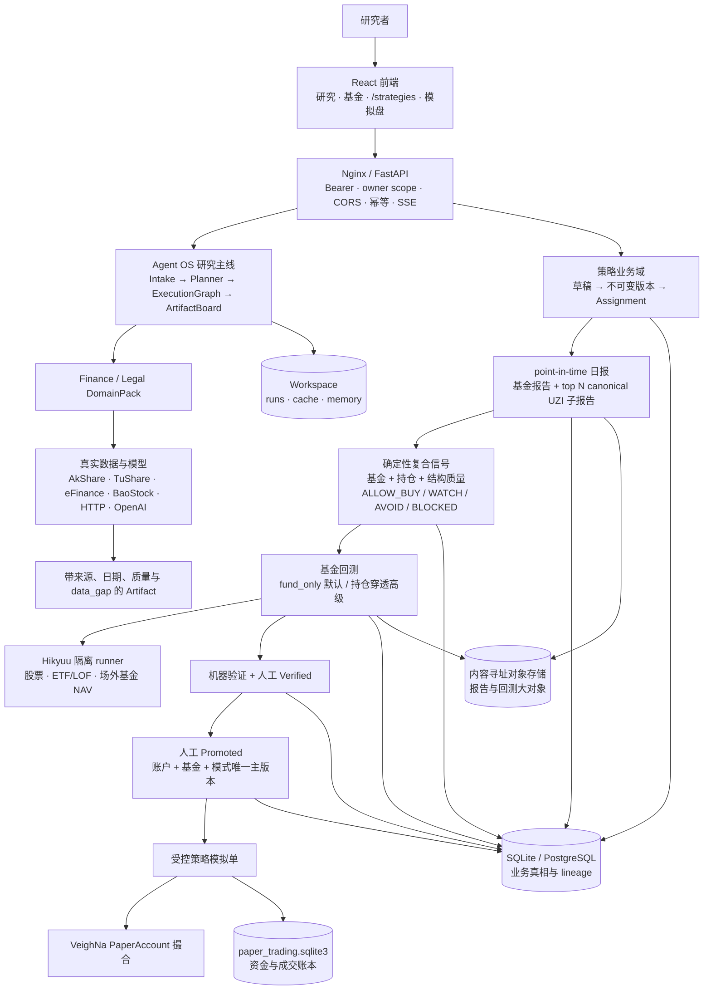
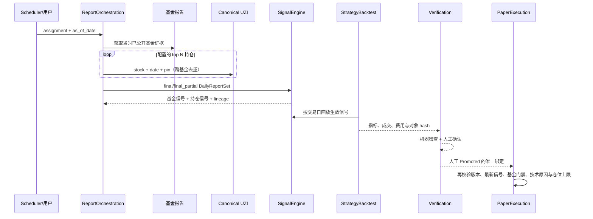

# Cognitrade 当前架构

本文只描述当前可运行主线。历史 CLI、ResearchOrchestrator、动态 Subagent discovery、
`/methodology`、自由参数 `/backtesting` 前端和旧 `/api/v2/finance/backtests/**` API 均已退出。
当前只有受版本治理的基金回测主线。

## 一图看懂



更适合展示的 PlantUML 渲染见：

- [易读版 SVG](./cognitrade-architecture-cn-simple.svg)
- [易读版 PNG](./cognitrade-architecture-cn-simple.png)
- [PlantUML 源码](./cognitrade-architecture-cn-simple.puml)

## 核心边界

| 层 | 当前职责 |
| --- | --- |
| `frontend` | `/strategies` 是唯一策略入口；基金报告只传完整 fund/assignment/report/version/mode/holding lineage 上下文，不直接制造交易参数 |
| `api` | 版本路由、鉴权、owner scope、请求 ID、CORS、持久化幂等与错误信封 |
| `runtime` | Agent OS Turn/Task、执行图、工具治理、恢复、ArtifactBoard 和质量门 |
| `domain_packs/finance_ashare` | 基金与个股真实数据、UZI 研究、公开时间与来源合同 |
| `strategies/contracts.py` | 可注册因子、固定权重、质量门、执行/费率/pin 的封闭策略 schema 与 canonical hash |
| `strategies/service.py` | 策略 CRUD、乐观锁、不可变版本、Assignment、治理状态与审计 |
| `strategies/orchestration.py` | 一天一份报告、attempt/lease、top N UZI 去重、失败重试、暂停/恢复、补跑与 late revision |
| `strategies/signals.py` | 纯函数式基金/持仓四态信号、coverage/confidence、carry 与 supersession |
| `strategies/backtesting/` | 严格版本输入、point-in-time 预检、三类资产、默认基金本体与高级持仓穿透、费用及逐笔 lineage |
| `strategies/verification.py` | 无前视、lineage、确定性、coverage、样本、费用及绩效门槛 |
| `strategies/paper_execution.py` | 仅 Promoted 版本、精确信号和冻结执行配置可进入现有模拟盘 |
| `api/paper_trading_service.py` | 独立资金/持仓/费用/T+1/FIFO 账本，接受策略版本冻结 execution profile |
| `strategies/backtesting/hikyuu_signal_runner.py` | API 主进程外执行唯一受治理的 Hikyuu 技术信号操作 |

## 报告到交易的时序



`BLOCKED` 表示证据不足，既不能买，也不能因为“数据失败”自动卖。报告公开时间晚于交易日、
缺少可信公开时间、版本/hash 不一致或信号已被 late revision 取代时都会拒绝执行。

## 持久化与部署

```text
workspace/
  runs/                    # Agent OS Run/Turn/Task/Artifact
  cache/                   # 可重建数据缓存
  memory/                  # episodic/domain/policy memory
  paper_trading/           # VeighNa 外围资金账本
  backtests/               # 旧技术回测只读 JSON；不再生成或通过 API 列出
  strategy_objects/        # 内容寻址的报告/曲线/快照与 Hikyuu 隔离运行时
  backups/strategy_migrations/
  .migrations/             # 工作区与旧对象索引标记
  cognitrade.sqlite3       # 本地单实例策略业务库
```

生产多实例把业务库切到 PostgreSQL，并使用所有实例共享的持久化对象目录。普通 API 启动不
建表、不迁移；`scripts/deploy.sh migrate` 严格按“备份 → Alembic → 旧对象只读索引 → 工作区
迁移”执行。保留清理器先查询 `ArtifactObjectRef`，引用查询失败时 fail closed，不删除文件。

## 兼容边界

- `FundHoldingReportService` 仍承担旧批次 API 与报告导出，并被新日报协调器作为受控运行适配器调用；其仍被调用的部分不能删除。
- 旧 `/backtests/**` 后端 API、自由参数策略目录和文件持久化服务均已删除；旧 JSON 只建立引用索引，不进入基金回测列表。
- 已发布日报、版本、信号、验证、成交和它们引用的对象永久保留；旧文件只建索引，不移动或重写。
- 与本方案无关的 UZI qualitative 代码保持原样。
