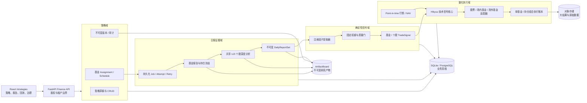

# 基金报告—策略信号—回测系统一体化实施方案

状态：已按冻结方案完成阶段 A–G
方案日期：2026-08-11；落地日期：2026-08-12
范围：策略工作台、每日基金与持仓 UZI 报告、确定性信号映射、Hikyuu 回测、验证与模拟交易治理

## 1. 结论

本次不能只把“基金报告里的股票代码”继续传给现有回测页。正确的落地方式是新增一个独立的策略域，并在 Agent OS 报告与 Hikyuu 之间建立两层不可变合同：

1. `DailyReportSet`：某基金在某个 `as_of_date` 下可追溯的基金报告、持仓披露及持仓股票 UZI 报告集合。
2. `TradeSignal`：某个已发布策略版本对上述报告集合进行确定性映射后产生的基金或个股许可状态。

Hikyuu 只消费已生效的 `TradeSignal` 和对应行情，不直接读取报告叙事文本，也不自行解释大模型结论。每一笔回测成交必须反向引用策略版本、日报版本和信号 ID。

前端统一使用 `/strategies`。旧 `/methodology` 路径和旧的本机策略原型不再作为运行入口；方法论内容移动到策略详情的“治理”标签页。

## 2. 已冻结的产品边界

### 2.1 策略与版本

- 用户可以从零创建策略，也可以复制只读系统模板。
- 个人策略按 `tenant_id + user_id` 私有隔离；首版不做团队协作编辑。
- 一个策略只有一个工作草稿，使用 `draft_revision` 乐观锁。
- 草稿可修改；发布后内容不可变。再次修改从已发布版本创建新草稿并发布新版本。
- 回测固定绑定 `strategy_id + strategy_version_id + content_hash`。
- 未发布且无引用的草稿可物理删除；存在已发布版本的策略只能归档，可恢复。
- 生命周期为 `Draft → Published → Verified → Promoted`。
- `Published` 只允许产出报告、信号和回测；`Verified` 由自动检查通过后人工确认；`Promoted` 才能进入模拟交易。
- 首版不接实盘。
- Published 策略可以选择是否创建自动日程；Draft 不能调度。归档策略会暂停其全部 Assignment，但不删除历史版本、信号或回测。

### 2.2 报告与信号

- 基金自身报告和基金持仓生成的 UZI 个股报告都是信号输入。
- 对支持的权益基金，持仓个股 UZI 深度分析是强制模块，不能关闭。
- 用户可以关闭持仓股票独立信号或 `holdings_portfolio` 回测，但不能停止个股分析参与基金复合信号。
- 基金复合模型默认权重：基金表现/风险 40%、持仓个股质量 40%、持仓结构/数据质量 20%。权重可配置且随策略版本冻结。
- 首版只允许选择已登记因子并编辑权重、阈值和质量门槛，不执行任意公式、任意代码或任意 JSON 表达式。
- 信号状态固定为 `ALLOW_BUY / WATCH / AVOID / BLOCKED`。
- 报告信号只授予或撤销交易许可；真正的买卖点由技术执行规则产生。
- `ALLOW_BUY`：允许等待技术买点。
- `WATCH`：不新开仓；已有仓位仍可因技术退出或信号过期退出。
- `AVOID`：不新开仓；已有仓位在下一可交易时点退出。
- `BLOCKED`：不新开仓；不能仅因数据缺失强制卖出，已有技术风控仍然有效。

### 2.3 日频、补跑与修订

- 每个交易日形成一份 `as_of_date` 报告，忽略生成时刻对回测日粒度的影响，但保留 `created_at` 供审计。
- 报告只能使用在 `as_of_date` 当日已经公开的数据；信号默认从下一交易日生效。
- 同一基金/股票、日期、UZI 固定版本和输入哈希相同的分析只生成一次，跨策略复用。
- 不同策略只重新执行确定性因子提取和信号映射，不重复调用大模型。
- 失败或超时支持手动只重试失败节点；完整重跑是需要确认的高级操作。
- 重试产生新 attempt 和新 Artifact，不覆盖旧产物。
- 日报结算前完成的重试可以进入当日日报；结算后完成则生成修订版，从下一交易日生效。
- 日报缺失时可沿用上一信号，默认最多 3 个交易日；之后变为 `BLOCKED`。
- 历史补跑首版支持，单任务默认最多 60 个交易日；更长区间拆分子任务。
- 补跑前返回预计基金报告数、唯一股票分析数、模型调用上限和缓存命中数。
- 补跑必须使用 point-in-time 数据；无法证明当时可得的数据不能用当前值代替，只能跳过并标记 `BLOCKED`。

### 2.4 回测

- 回测模式互斥：`fund_only` 或 `holdings_portfolio`。
- 首版不允许基金与持仓股票同时混合持有，避免重复暴露。
- `fund_only` 默认基准为目标基金同期买入并持有，并在可识别时增加类别指数。
- `holdings_portfolio` 默认基准为期初披露权重静态持有，并增加沪深 300。
- 持仓组合按披露权重或 ETF 联接穿透后的有效权重配置；信号失败部分保留现金，不强制归一化到 100%。
- 每日评估，但只在信号状态变化、基金总门禁变化、新持仓披露、偏离目标权重超过默认 2 个百分点，或风险/技术退出时交易。
- 回测页只能选择日期、初始资金、目标基金、模式、基准以及使用现有报告或触发补跑，不能临时覆盖策略规则。

### 2.5 支持资产

- 首版支持具有 A 股权益暴露且持仓、净值可审计的股票型、偏股混合型、A 股指数基金、ETF、ETF 联接、LOF 和可穿透 FOF。
- 首版排除纯债、货币、商品、QDII，以及无法可靠取得持仓或净值的基金。
- 统一使用一个 Hikyuu 核心，并提供股票、场内基金、场外开放式基金三类资产适配器。
- 场外基金缺少完整历史费率时使用策略版本中的保守费率并标记“降级估算”；缺少申赎开放状态或确认规则等关键交易约束时阻止回测。

## 3. 当前仓库事实与必须修正的差距

| 当前事实 | 影响 | 处理方式 |
| --- | --- | --- |
| `ReportSignalMapping` 只保存在浏览器 `localStorage` | 后端、回测和其他设备均不可消费 | 由数据库中的策略草稿和不可变版本替代；localStorage 仅保留表单恢复副本 |
| 前端路由仍是 `/methodology` | 与统一策略工作台不一致 | `ViewId` 改为 `strategies`，唯一入口 `/strategies`，不保留旧路由 |
| 基金报告点击回测只把 `symbol/name/fundCode/fundName/sourceRunId` 放入 React 内存 | 刷新丢失；后端最终只收到股票代码和自由 MA 参数 | 改为持久化的策略版本、基金、日报和回测模式合同；页面跳转使用可恢复查询参数 |
| Hikyuu runner 强制 `STOCKTYPE_A`、100 股整手和 A 股费率 | 不能正确回测 ETF/LOF/场外基金 | 引入 `AssetAdapter`，按资产类型构建 KData、费用、交易单位和结算规则 |
| Hikyuu 只运行单标的固定均线策略 | 无法消费日报信号或回测持仓组合 | 新增报告门禁信号适配器和组合执行账本 |
| 回测结果是全局 JSON 文件，列表接口未按用户/租户隔离 | 存在跨用户可见风险，也不能可靠查询版本关系 | 数据库保存归属、策略版本和结果元数据；大曲线/成交明细进入内容寻址对象存储 |
| `FinanceMarketDataService` 只解析 A 股股票，且没有日期区间和 `as_of_date` 合同 | 基金行情、净值和历史回测输入不统一 | 新增 `InstrumentResolver` 和 point-in-time `MarketDataGateway` |
| `FundHoldingReportService` 绑定某个来源运行，并为每个基金批次重复创建股票 child run | 同一股票/日期无法跨基金复用 | 把 canonical UZI 股票分析从基金上下文中解耦，再生成无模型调用的基金上下文链接 Artifact |
| `freeze_fund_holdings` 把持仓数硬编码为 10 | 无法实现 5–20 可配置 | 接受 `top_n`，由同日所有活跃策略的最大需求决定共享生成集合 |
| 当前陈旧状态在 120 天时仅 warning，180 天才要求确认 | 与默认 120 天阻断不一致 | 报告展示可以 warning；交易信号质量门使用策略版本的 120 天硬门槛 |
| 当前单基金 `fund_analysis.score` 为 `null` | 无法直接用作基金交易分数 | 新增绝对、版本化因子归一化器；不复用横向排名分数作为交易信号 |
| 当前基金比较分数会除以“已观测权重”重新归一化 | 缺失因子会放大剩余因子 | 信号引擎使用固定权重和上下界，不动态重分配 |
| 当前基金快照多数只记录报告期末，没有统一公开时间 | 历史补跑可能发生前视偏差 | 新增 `published_at / first_seen_at / retrieved_at` 可得性账本；不能证明可得时直接阻断 |
| 现有调度主要是进程内线程池 | 重启恢复、跨实例抢占和大规模补跑能力不足 | 新增数据库 job、attempt、节点状态和租约；进程内 worker 只是执行器，不是状态真相 |

## 4. 目标架构



### 4.1 职责边界

- Agent OS/DomainPack：取得证据、运行基金研究和完整 UZI 个股研究、产生 Artifact。
- 策略域：管理用户意图、草稿、发布版本、Assignment、治理状态和审计。
- 信号域：只读取结构化字段，用纯函数产生可重放的分数、质量状态和交易许可。
- Hikyuu：根据已生效许可与行情计算技术买卖条件。
- 执行账本：应用资产单位、费用、T+1、申赎确认、组合权重和现金约束。
- 数据库：保存可查询业务状态和引用；ArtifactBoard：保存不可变研究/策略快照；对象存储：保存大体积不可变对象。

## 5. 策略版本合同

发布时把编辑表单规范化为 `StrategyDocumentV1`，按键排序后计算 SHA-256。数据库和 ArtifactBoard 存放完全相同的规范化文档与哈希。

```text
StrategyDocumentV1
├── metadata
│   ├── schema_version
│   └── description
├── pins
│   ├── uzi_methodology_version
│   ├── uzi_source_commit
│   ├── model_id / model_parameters
│   ├── prompt_hash
│   ├── output_schema_versions
│   └── factor_extractor_version
├── report_inputs
│   ├── holding_uzi_required = true
│   ├── research_profile = deep
│   ├── top_n = 5..20
│   └── supported_fund_types
├── fund_composite
│   ├── fund_performance_risk.weight
│   ├── holding_stock_quality.weight
│   └── holding_structure_quality.weight
├── factor_weights
│   ├── registered fund factors
│   ├── registered holding factors
│   └── registered structure factors
├── signal_thresholds
│   ├── buy / watch / minimum_confidence
│   └── missing_report_carry_days
├── quality_gates
│   ├── normal_coverage / minimum_coverage
│   ├── max_holding_staleness_days
│   ├── report_allowed / critical / symbol_match
│   └── point_in_time_required
├── execution
│   ├── technical_rule = ma_cross
│   ├── fast_period / slow_period
│   ├── max_single_stock_pct
│   └── rebalance_drift_pct_points
├── asset_execution
│   ├── stock rules
│   ├── exchange fund rules
│   └── OTC fund confirmation / fee fallback rules
└── schedule_defaults
    ├── timezone = Asia/Shanghai
    └── local_time = 16:30
```

### 5.1 首版注册因子

基金表现/风险复用当前方法论的七类真实字段，但用新的绝对归一化器产生 0–100 分：

- 近一年收益
- 长期年化收益
- 近一年相对基准收益
- 最大回撤
- 年化波动率
- 费率
- 收益一致性

默认子权重沿用当前 20/15/15/20/15/5/10。归一化断点属于代码中的版本化因子注册表，首版不允许用户修改公式。

持仓个股质量首版只使用通过质量门的 UZI `synthesis.overall_score`，避免把已经进入总分的基本面或评审团分数再次重复计权。

持仓结构/数据质量首版登记：

- 已分析持仓数量覆盖率
- 已分析披露权重覆盖率
- 披露新鲜度
- 前 N 大持仓集中度风险
- ETF/FOF 穿透完整度
- 不支持证券权重占比

### 5.2 缺失数据算法

不进行中性填充，也不把剩余因子重新归一化。每层分数同时计算：

- `score_lower_bound`：只计入已有正向证据，缺失部分不贡献分数。
- `score_upper_bound`：假设缺失部分达到最高分，仅用于展示不确定区间。
- `decision_score`：固定取 lower bound，用于实际状态判定。
- `coverage`：默认取数量覆盖率与披露权重覆盖率中更低者；没有可靠权重时退化为数量覆盖率并增加 `weight_coverage_unavailable`。
- `confidence`：取三个强制复合模块置信度的最小值，再受总体 coverage 上限约束，避免高质量模块掩盖低质量模块。

质量门顺序固定：

1. point-in-time、symbol、schema、`report_allowed`、critical 等硬门。
2. 持仓陈旧度和覆盖率门。
3. 最低置信度门。
4. 固定权重分数阈值。
5. coverage 在 60%–80% 时把最终状态上限压到 `WATCH`；低于 60% 直接 `BLOCKED`。

### 5.3 系统模板 `equity_fund_report_v1`

系统模板只读，用户可复制后编辑，也可以完全从零创建。首版 seed 必须幂等，默认值为：

| 配置 | 默认值 |
| --- | --- |
| 基金表现/风险、持仓个股质量、持仓结构质量 | 40% / 40% / 20% |
| 买入、观察、最低置信度 | 70 / 55 / 0.65 |
| UZI 分析范围 | 完整 deep profile，前 10 大持仓 |
| 正常/最低 coverage | 80% / 60% |
| 持仓最长陈旧时间 | 120 天 |
| 缺失日报沿用 | 3 个交易日 |
| 技术执行 | 报告门禁 + MA5/MA20 |
| 单只股票上限 | 20% |
| 再平衡偏离门槛 | 2 个百分点 |
| 日程 | 交易日 16:30，Asia/Shanghai |

## 6. 数据模型

使用 SQLAlchemy Repository + Alembic 迁移，避免继续增加手写 SQLite 专用表。默认本地数据库为 `workspace/cognitrade.sqlite3`；生产读取 `COGNITRADE_DATABASE_URL` 连接 PostgreSQL。SQLite 开启 foreign keys、WAL 和 busy timeout。

所有 Repository 方法都显式接收 owner scope。启用鉴权时使用 Token 绑定的 `tenant_id + user_id`；本地免登录模式统一归属 `tenant_id=local, user_id=local_development`，不允许产生 owner 为空的个人策略。

### 6.1 策略与治理表

| 表 | 关键字段与约束 |
| --- | --- |
| `strategies` | `id, tenant_id, user_id, name, kind, is_system_template, lifecycle, archived_at, created_at, updated_at`；个人查询必须带完整 owner scope |
| `strategy_drafts` | 每策略最多一行；`base_version_id, draft_revision, document_json, validation_json` |
| `strategy_versions` | `strategy_id, version_number, document_json, content_hash, published_at, published_by`；唯一且不可 UPDATE/DELETE |
| `strategy_events` | 保存 create/save/publish/archive/restore/verify/promote/delete/conflict 等审计事件 |
| `strategy_assignments` | `fund_code, strategy_id, active_version_id, pending_version_id, effective_from, mode, schedule, enabled, paused`；禁止隐藏参数覆盖 |
| `strategy_verifications` | 固定版本、回测引用、强制检查、绩效条件、机器结果、人工确认人和时间 |
| `paper_strategy_bindings` | 模拟账户、基金、模式、唯一 promoted 主版本；数据库约束防止同一作用域出现两个主策略 |

Assignment 允许同一基金绑定多套策略用于独立实验，但信号永不合并。新版本发布后，普通报告/信号 Assignment 的 `pending_version_id` 从下一交易日切换为 active；模拟交易仍固定使用原 Promoted 版本，直到新版本独立通过 Verified 并由用户再次 Promoted。

### 6.2 日报、任务与证据表

| 表 | 关键字段与约束 |
| --- | --- |
| `orchestration_jobs` | `job_type, owner_scope, status, idempotency_key, requested_range, progress, pause/cancel flags, lease_owner, lease_until` |
| `job_attempts` | 每次执行/手动重试单独一行，保存父 attempt、选择节点、错误摘要和时间 |
| `daily_report_sets` | `fund_code, as_of_date, pin_set_hash, revision, status, max_top_n, coverage, source_hash, effective_date`；已 final 的 revision 不可变 |
| `daily_report_nodes` | `fund_report` 或 `holding_uzi` 节点；保存 symbol、rank、weight、run/artifact ID、input/content hash、状态和缺口 |
| `evidence_observations` | `subject, source, event_date, published_at, first_seen_at, retrieved_at, content_hash, artifact_id`；负责 point-in-time 判定 |
| `factor_snapshots` | 按主体、日期、提取器版本保存结构化因子、缺失项、上下界、confidence 与来源 Artifact 引用 |

### 6.3 信号与回测表

| 表 | 关键字段与约束 |
| --- | --- |
| `trade_signals` | `kind, subject_code, strategy_version_id, assignment_id, as_of_date, revision, state, score bounds, confidence, effective_from, expires_after, source_report_set_id, content_hash` |
| `backtest_runs` | owner、策略版本、基金、模式、日期、资金、基准、输入快照哈希、引擎版本、状态、指标摘要、结果对象引用 |
| `backtest_signal_links` | 回测使用的每个 signal ID、交易日和使用原因；保证结果可重放 |
| `artifact_object_refs` | 数据库记录到 ArtifactBoard/对象存储对象的引用、哈希、大小、保留级别和引用计数 |

关键外键使用 `RESTRICT`：已发布版本、日报、信号、验证或回测被引用后不能物理删除。

## 7. 日报编排

### 7.1 正常日任务

1. 调度器在交易日 16:30（Asia/Shanghai）为 enabled assignment 建立幂等任务。
2. 按 `fund_code + as_of_date + pin_set_hash` 合并需求，计算当日最大 `top_n`。
3. 取得或生成当日基金 snapshot、fund analysis 和 research report。
4. 用可得性账本选择 `available_at <= as_of_date cutoff` 的最新披露，不按报告期末直接判断可用。
5. 冻结直接持仓或 ETF/FOF 穿透有效持仓。
6. 按 `symbol + as_of_date + UZI pins + input_hash` 查询共享 UZI 结果；缓存未命中才创建完整 `stock_check`。
7. 为每个基金生成轻量的 `fund_holding_stock_report_link`，引用共享 UZI Artifact 并附加该基金的 rank、weight、disclosure 信息。
8. 所有节点完成或达到结算门槛后写入不可变 `DailyReportSet revision`。
9. 对所有绑定策略版本执行因子提取和信号映射。
10. 将信号标记为下一交易日生效。

非交易日不创建自动日报。用户仍可执行“立即运行”和历史补跑；立即运行同样必须指定 `as_of_date` 并遵守数据可得性规则。

默认运行结算截止建议为下一交易日 08:30。截止时未完成的节点进入 coverage 与 `BLOCKED/WATCH` 规则；截止后重试成功生成下一 revision，并从再下一交易日生效。该时间是 assignment 可配置的运行参数，不进入策略评分公式。

### 7.2 共享与内容寻址

- UZI 大模型输入哈希不能包含基金名称、基金权重等展示上下文，否则同一股票无法共享。
- 基金上下文作为派生链接 Artifact，不重新调用大模型。
- 同一股票被多个基金持有时，所有基金引用同一 canonical UZI Artifact。
- 同一日存在 top 10 和 top 20 策略时只生成 top 20；每个策略按自身 top N 截取并计算覆盖率。
- 策略阈值或权重修改只产生新 `factor_snapshot/trade_signal`，不重新生成报告。
- 只有报告输入、UZI/prompt/model/schema/extractor pin 变化才失效缓存。

### 7.3 手动重试与补跑

- `retry_failed_nodes`：默认动作，只选择 failed/timed_out 节点。
- `rerun_all`：需要二次确认，创建完整新 attempt。
- attempt 不覆盖旧 run/artifact；日报通过 revision 引用本次选中的成功产物。
- 后台任务具有 `queued/running/paused/completed/completed_partial/failed/cancelled` 状态。
- worker 使用数据库租约和心跳；服务重启后过期租约可被恢复。
- PostgreSQL 多实例使用 `FOR UPDATE SKIP LOCKED`；SQLite 本地使用单 worker 和事务锁。
- 免费或会休眠的后端可以由外部 cron 调用受保护、幂等的 scheduler tick；业务状态仍以数据库为准。

## 8. Hikyuu 与执行适配

### 8.1 统一输入

新增 `TradableInstrument`：

```text
instrument_id, code, name, asset_type,
exchange, currency, price_precision, quantity_precision,
board_lot, settlement_rule, fee_model_id, calendar_id
```

新增 `MarketDataGateway.get_series(instrument, start_date, end_date, as_of_date)`：

- 股票、ETF、LOF 返回 OHLCV。
- 场外基金返回单位净值、累计净值、分红及开放状态。
- 场外基金送入 Hikyuu 的 KRecord 使用 `open=high=low=close=nav, volume=amount=0`。
- 所有序列在送入回测前截断到请求区间，并记录数据内容哈希。

### 8.2 报告门禁技术信号

使用 Hikyuu 自定义 `SignalBase/crtSG` 生成可审计的日期信号：

- 买入：当日有效报告状态为 `ALLOW_BUY`，且 MA5 上穿 MA20。
- 技术退出：MA5 下穿 MA20。
- `AVOID`：在下一可交易日追加强制退出信号。
- `WATCH/BLOCKED`：禁止新增买入；不会仅因 `BLOCKED` 追加卖出。
- 每个 Hikyuu 信号事件携带外部映射表，结果成交写回对应 `trade_signal_id` 和 technical reason。

### 8.3 三类适配器

| 适配器 | Hikyuu 使用方式 | 交易账本规则 |
| --- | --- | --- |
| `AStockAdapter` | `STOCKTYPE_A`、股票 KData、报告门禁 SG | 100 股整手、T+1、股票佣金/过户费/卖出印花税 |
| `ExchangeFundAdapter` | `STOCKTYPE_ETF/FUND`、场内 KData、报告门禁 SG | ETF/LOF 整手、对应费率、无股票印花税规则 |
| `OTCFundAdapter` | Hikyuu KData 和技术/报告日期信号 | Cognitrade 金额申购账本负责确认日、份额精度、申赎费、分红、暂停申赎和待确认现金 |

场外基金不强行套用股票 `SYS_Simple + MM_FixedCount`。Hikyuu 仍负责统一 KData、指标和信号，申赎执行由可测试的场外基金账本处理。

### 8.4 两种回测模式

`fund_only`：

- 根据基金信号和基金自身价格/NAV 技术条件持有或退出该基金。
- 场内基金按下一交易日行情成交；场外基金按策略冻结的申赎确认规则执行。

`holdings_portfolio`：

- 基金信号是组合总门禁；个股信号决定各持仓是否可进入目标权重。
- 目标权重来自最新当时可得的披露/穿透权重，并受单票 20% 默认上限约束。
- 缺失或不可买持仓的权重保留现金。
- 每日计算目标，但只在已冻结的再平衡事件发生时交易。
- 多资产资金、费用和持仓由确定性组合账本统一计算；每只股票的技术事件仍由 Hikyuu 产生。

## 9. API 设计

新接口作为 `/api/v2/finance` 的增量资源，不破坏现有行情和模拟盘合同。迁移已经完成：旧自由参数回测接口、服务和策略目录均已删除，只保留旧结果文件的只读引用索引。

### 9.1 策略

```text
GET    /api/v2/finance/strategy-catalog
GET    /api/v2/finance/strategies
POST   /api/v2/finance/strategies
GET    /api/v2/finance/strategies/{strategy_id}
PATCH  /api/v2/finance/strategies/{strategy_id}/draft
DELETE /api/v2/finance/strategies/{strategy_id}
POST   /api/v2/finance/strategies/{strategy_id}/clone
POST   /api/v2/finance/strategies/{strategy_id}/publish
POST   /api/v2/finance/strategies/{strategy_id}/archive
POST   /api/v2/finance/strategies/{strategy_id}/restore
GET    /api/v2/finance/strategies/{strategy_id}/versions
GET    /api/v2/finance/strategies/{strategy_id}/versions/{version_id}
GET    /api/v2/finance/strategies/{strategy_id}/version-diff
```

草稿读取返回 ETag；保存要求 `If-Match: <draft_revision>`。冲突返回 HTTP 409 和 `draft_revision_conflict`，并附带最新 revision，前端提供“加载最新、比较、另存为新策略”。

### 9.2 Assignment、报告和信号

```text
GET/POST/PATCH/DELETE /api/v2/finance/strategy-assignments[/{id}]
POST /api/v2/finance/strategy-assignments/{id}/pause
POST /api/v2/finance/strategy-assignments/{id}/resume

POST /api/v2/finance/report-jobs
GET  /api/v2/finance/report-jobs/{id}
POST /api/v2/finance/report-jobs/{id}/retry
POST /api/v2/finance/report-jobs/{id}/pause
POST /api/v2/finance/report-jobs/{id}/resume
POST /api/v2/finance/report-backfills/estimate
POST /api/v2/finance/report-backfills
GET  /api/v2/finance/daily-report-sets

POST /api/v2/finance/signal-previews
GET  /api/v2/finance/trade-signals
GET  /api/v2/finance/trade-signals/{signal_id}
```

`signal-previews` 可以接受未发布草稿，但只能读取已有真实日报并返回临时结果，不持久化为可交易信号。

### 9.3 回测与治理

```text
POST /api/v2/finance/strategy-backtests
GET  /api/v2/finance/strategy-backtests
GET  /api/v2/finance/strategy-backtests/{id}
POST /api/v2/finance/strategy-backtests/{id}/retry
POST /api/v2/finance/strategy-backtests/{id}/cancel

POST /api/v2/finance/strategy-verifications
GET  /api/v2/finance/strategy-verifications/{id}
POST /api/v2/finance/strategy-verifications/{id}/confirm
POST /api/v2/finance/strategies/{id}/versions/{version_id}/promote
```

回测创建合同只接受 `strategy_version_id, fund_code, mode, start_date, end_date, initial_cash, benchmark, report_policy`，不接受权重、阈值、MA 周期或费率覆盖。

所有 mutation 支持 idempotency key，所有查询和写入强制使用当前 principal 的 owner scope。CORS 增加 `DELETE` 和 `If-Match`。

## 10. 前端信息架构

### 10.1 `/strategies` 工作台

页面采用左侧列表、右侧详情：

- 列表过滤：系统模板、草稿、已发布、已归档。
- 新建入口：空白策略、复制系统模板。
- 详情标签：规则编辑、信号预览、版本历史、基金绑定、回测、方法论治理。
- 操作：重命名、保存草稿、发布、复制、删除草稿、归档、恢复、版本比较、创建 Assignment、启动回测。
- 系统模板显示只读锁；点击编辑时必须先复制。
- 发布前展示完整差异、数据 pin、质量门和执行参数，不允许静默发布。
- localStorage 只保存 `{strategy_id, server_revision, unsaved_form}`，服务端保存成功后清除。
- 如果检测到旧 `cognitrade.report-signal-policy.v1`，只显示一次“导入旧本机草稿”入口，不自动写入或删除。

### 10.2 基金报告页

- 基金级新增“生成信号”“使用策略回测”“查看当日日报”入口。
- 操作前选择已有 Published 策略或创建 Assignment。
- 个股列表显示对应 UZI 报告、个股信号、coverage 和来源日期。
- 个股“回测”不再直接打开自由 MA 股票回测；改为打开该基金 Assignment 的 `holdings_portfolio` 上下文。
- 页面传递 `fund_code, source_run_id, source_artifact_id, report_set_id, strategy_version_id, mode`，而不是只传股票代码。

### 10.3 回测页

- 输入：目标基金、Published 策略版本、模式、日期、资金、基准、报告获取策略。
- 如果日期内日报不足，先显示缺失日期和预计补跑成本，再由用户确认补跑。
- 结果显示策略版本哈希、UZI/model pin、日报覆盖、BLOCKED 天数、降级费率、基准、成交和 signal lineage。
- 每笔成交可跳转到对应日报、基金信号和个股 UZI Artifact。

### 10.4 方法论页面处理

- 删除独立 `Methodology` 路由和侧栏项。
- DomainPack 契约、质量门、Policy Memory、Verified/Promoted 记录移动到策略详情“方法论治理”标签。
- `/methodology` 直接落入应用的未知路径处理，不做重定向。

## 11. 后端代码落点

建议新增：

```text
research_system/persistence/
  database.py
  models/
  repositories/
  migrations/

research_system/strategies/
  schemas.py
  canonicalization.py
  registry.py
  service.py
  publication.py
  assignments.py
  verification.py

research_system/report_signals/
  jobs.py
  scheduler.py
  daily_reports.py
  uzi_dedup.py
  evidence_clock.py
  factor_extractors.py
  signal_mapper.py

research_system/backtesting/
  service.py
  signal_adapter.py
  market_data_gateway.py
  instruments.py
  adapters/stock.py
  adapters/exchange_fund.py
  adapters/otc_fund.py
  portfolio_ledger.py
  result_store.py

research_system/api/routes/strategies.py
research_system/api/routes/report_signals.py
research_system/api/routes/strategy_backtests.py
```

复用并逐步重构：

- `ArtifactBoard`：继续生成 content hash 和 lineage；增加策略发布、日报和回测 Artifact schema。
- `AgentOS` 与 `stock_check`：继续执行完整 UZI，不复制一套研究逻辑。
- `FundSnapshotSkill`：增加 `as_of_date` 和公开时间元数据，不在信号层重写基金采集。
- `TradingCalendar`：统一日报生效日、调度日和回测交易日。
- Hikyuu 技术核心：已拆为单一 report-gated signal runner 与三类资产的确定性账本适配器。
- `PaperTradingService`：在 Promoted 阶段抽出 instrument/fee/settlement 规则，避免继续写死股票规则。

最终可删除或替换：

- `frontend/src/report-signal-policy.ts`：由服务端策略合同和纯前端类型替代。
- `frontend/src/components/ReportSignalMapping.tsx`：由完整策略规则编辑器替代。
- `frontend/src/components/Methodology.tsx`：拆成策略工作台与治理标签后删除。
- `FundHoldingReportService` 的文件扫描、批次内去重和独立线程状态：新日报 coordinator 完整接管后删除；导出渲染能力保留为独立服务。
- `backtest_strategies.py` 的 UI 自由策略目录：已随旧自由回测入口删除；冻结 MA 规则来自不可变策略版本。

不会修改或删除与本方案无关的现有未提交 UZI qualitative 代码。

## 12. 数据迁移与兼容

1. 新建数据库和 schema version 表，不在正常启动中隐式迁移。
2. `scripts/deploy.sh migrate` 显式执行 Alembic，并在迁移前备份 SQLite/工作区索引。
3. 幂等写入系统模板 `equity_fund_report_v1`。
4. 扫描现有基金 Run/Artifact，只建立引用索引，不移动或重写原文件。
5. 只有存在可信 `published_at/first_seen_at` 的历史 Artifact 才可进入历史回测；其他记录标记 `point_in_time_unverified`。
6. 现有回测 JSON 导入为 `legacy_technical` 元数据，保留原文件，只读展示；不能用于 Verified/Promoted。
7. 旧 localStorage 策略只允许用户主动导入为新草稿。
8. 新前端切换 `/strategies` 后删除 `/methodology` 路由映射与旧组件。
9. 已完成：前端停止调用旧 `/backtests`，旧 API、运行服务和自由策略目录已删除，历史 JSON 只读保留。

## 13. 保留与清理

- 已发布日报、策略版本、信号、验证和回测引用的报告永久保留。
- 失败 attempt 诊断默认保留 30 天。
- 无引用临时文件、下载缓存和可重建缓存默认保留 90 天。
- 原始大对象和回测曲线进入内容寻址对象存储；数据库只保存哈希、URI、大小和引用。
- 清理器必须先解析数据库外键和 Artifact lineage；任何被引用对象都不能删除。
- 已发布版本不提供物理删除 API。

## 14. 分阶段实施顺序

### 阶段 A：合同与数据库底座

- 引入数据库配置、Repository、Alembic 和测试 fixture。
- 定义 StrategyDocument、注册因子、canonical hash、生命周期和错误合同。
- 建表、系统模板 seed、owner scope、乐观锁和审计事件。
- 验收：SQLite 全测通过；PostgreSQL repository 合同测试通过；相同文档稳定产生相同 hash。

### 阶段 B：策略 CRUD 与 `/strategies`

- 实现策略、草稿、发布、版本、归档、恢复、复制、删除和 diff API。
- 把前端重构为完整策略工作台；方法论成为治理标签。
- 移除 `/methodology`，实现可选旧本机草稿导入。
- 验收：从零创建和模板复制都可完成；冲突不会覆盖他人更新；已发布版本不能修改或删除。

### 阶段 C：point-in-time 日报与共享 UZI

- 建立 evidence availability ledger、job/attempt/lease 和日报 revision。
- 给基金采集增加 `as_of_date`；持仓 top N 改为参数。
- 解耦 canonical UZI 与基金上下文，实现跨基金/策略共享。
- 实现自动日任务、手动运行、失败节点重试、暂停/恢复和历史补跑估算。
- 验收：同一股票同日只调用一次 UZI；重启后任务可恢复；缺少公开时间的历史日期不会偷用当前数据。

### 阶段 D：确定性信号引擎与报告页联动

- 实现因子提取、固定权重上下界、coverage/confidence 和四态状态机。
- 持久化基金与个股信号，支持三日沿用和 late revision。
- 基金报告页接入 Assignment、日报、信号和策略入口。
- 验收：同一输入与策略 hash 始终产生同一 signal hash；阈值修改不触发 UZI；所有信号能追溯到 Artifact。

### 阶段 E：Hikyuu 三类资产与两种回测

- 拆分 instrument、market data、signal、asset adapter 和 portfolio ledger。
- 实现股票、ETF/LOF、场外基金 NAV；实现 fund_only 与 holdings_portfolio。
- 回测页面切换到已发布版本合同，加入补跑预检和完整 lineage。
- 验收：每笔成交包含 signal ID；BLOCKED 不触发数据失败卖出；费用/确认规则按资产生效；两模式结果可重复。

### 阶段 F：验证、晋级与模拟交易

- 自动验证无前视、lineage、确定性、coverage、样本天数/信号数、费用完整性和配置的绩效门槛。
- 可配置绩效门槛至少包括最大回撤、年化收益、Sharpe、超额收益、换手率和费用影响；门槛快照属于 verification 记录，不反向修改策略版本。
- 人工确认 Verified；人工 Promoted；保证同一基金/模式/账户单一主策略。
- Promoted 版本接入现有模拟交易，Published 版本不能下单。
- 验收：未 Verified 无法 Promoted；新发布版本不会自动替换正在模拟交易的旧 Promoted 版本。

### 阶段 G：迁移、保留、部署与删除旧代码

- 索引旧 Artifact/回测、实现引用安全清理、更新 Docker/部署预检/API 文档/架构文档。
- GitHub Pages 构建增加 SPA 404 fallback，保证直接访问 `/strategies` 可恢复。
- PostgreSQL 生产配置和对象存储配置进入部署检查。
- 完成新旧回归后删除前端原型与不再调用的旧协调代码。
- 验收：新环境从迁移到健康检查一键通过；旧数据只读可访问；引用对象不会被清理。

## 15. 自动验证矩阵

### 15.1 后端

- 生命周期状态机和非法转换。
- 策略 JSON 规范化、hash、权重和阈值校验。
- 系统模板只读、owner scope、跨租户拒绝。
- draft revision 409 冲突与 publish 事务并发。
- hard delete、archive、restore 和 FK RESTRICT。
- point-in-time 公开时间边界和无前视性质测试。
- top 5/10/20 合并、跨基金股票去重和 pin 失效。
- failed-only retry、whole rerun、late revision、三日 carry-forward。
- coverage 59.99/60/79.99/80 边界。
- 缺失因子不重权、score bounds 与 BLOCKED/WATCH 上限。
- 股票、ETF、LOF、OTC NAV/费率/确认日 fixture。
- fund_only 与 holdings_portfolio 确定性 golden tests。
- 每笔成交的 strategy/report/signal lineage 完整性。
- SQLite 与 PostgreSQL repository 合同一致性。

### 15.2 前端

- `/strategies` 路由；`/methodology` 不匹配旧页面。
- 空白创建、模板复制、编辑、保存、发布、归档、恢复、删除。
- 只读模板和已发布版本不可编辑。
- 乐观锁冲突三种处理路径。
- 使用真实日报的信号预览，不渲染伪造示例分数。
- 基金报告进入策略/信号/回测时携带完整上下文。
- 回测表单不存在策略参数覆盖控件。
- 补跑成本确认、重试、暂停、恢复和错误状态。
- 移动端、键盘操作、焦点管理和破坏性操作确认。

### 15.3 端到端验收场景

1. 从零创建策略，保存草稿，发布 v1，绑定一只权益基金。
2. 生成某交易日日报，确认基金报告和前十大完整 UZI 子报告。
3. 第二只基金包含相同股票时复用同一 canonical UZI Artifact。
4. 模拟一个模型失败，只重试该股票，旧 attempt 保留。
5. 修改阈值并发布 v2，只重算信号，不重新运行 UZI。
6. 分别运行 fund_only 和 holdings_portfolio，检查基准、现金、费用和 signal lineage。
7. 用缺少 point-in-time 证据的历史日期补跑，确认输出 BLOCKED 而不是当前数据。
8. 自动验证后人工 Verified/Promoted；确认同一模拟账户无法出现两个主策略。

## 16. 完成定义

只有同时满足以下条件才算“打通”，不能以页面看起来可编辑作为完成：

- 策略 CRUD、删除/归档、不可变版本、审计和租户隔离落到数据库。
- 每份日报具有 `as_of_date`、revision、input/content hash 和完整 Artifact 引用。
- 基金个股 UZI 分析每日执行且可跨基金复用。
- 信号完全由版本化纯函数产生，缺失数据不会重权或中性填充。
- 基金与个股四态信号可查询、可预览、可回放。
- Hikyuu/执行账本支持三类资产和两种回测模式。
- 每笔成交可以追溯到策略版本、日报和信号。
- 历史补跑、失败节点重试、暂停/恢复和 late revision 均可用。
- Published、Verified、Promoted 权限边界实际阻止非法执行。
- `/strategies` 是唯一策略入口，旧 `/methodology` 不存在。
- 所有单元、合同、集成、前端和端到端测试通过。
- 部署迁移、PostgreSQL、保留清理和重启恢复经过验证。

## 17. 明确不在首版内

- 实盘下单。
- 任意用户代码、任意公式 DSL 或任意 JSONPath 作为策略。
- 多人同时协作同一草稿。
- 基金与持仓股票混合持有模式。
- 债券、货币、商品、QDII 等非目标基金回测。
- 自动把新发布版本晋级到模拟交易。
- 用当前数据、推断发布时间或中性值修补历史数据缺口。
