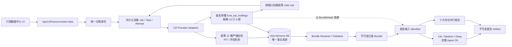

# 行情数据获取与报告生成解耦：Point-in-Time 数据中心实施方案

状态：已实施（核心链路落地；真实 provider 全量数据与性能验收为持续项）
方案日期：2026-08-20
适用基线：Cognitrade `codex/benchmark-uzi-concurrency-fixes`；UZI Skill `3.9.4` / `b004d7a988ca53a4805bf36784af091fa1209f22`

### 实施结果摘要

已落地的主路径包括：

- `research_system/market_data/` 中的动态 22 collector 契约、PIT/证据模型、不可变
  快照、时序点、冲突、resolver、Bundle 发布/物化、显式采集、归档订阅、
  provider capability、report manifest 与应用服务。
- Alembic `20260820_0003_market_data_point_in_time.py` 以共享 SQLAlchemy Base 建立
  evidence/snapshot/job/task/result/conflict/bundle/subscription/report-manifest 等持久化表；
  `20260820_0004_fund_holding_inputs.py` 增加基金父子 Job 谱系和 report manifest
  父 Bundle/快照依赖。
- `/api/v2/finance/market-data/**` 的统一 instrument identity、contract、coverage、snapshot、job/retry/cancel、
  manual/revoke/conflict、bundle、subscription、provider 和 report-manifest 端点。
- 旧 `GET /api/v2/finance/market-data/{symbol}` 在生产绑定下已切换为已发布 Bundle
  的数据库只读投影；`refresh` 不再启动外部采集。
- Agent OS 正式个股 Lite / Medium / Deep、基金持仓子报告与日报的
  `bundle_only` 预检、单股/组合 manifest 冻结、hash 校验和缺 Bundle 硬失败。
- 基金输入独立为单槽 `fund_top_holdings` 契约：固定展开精确 10 只 A 股，
  每只股票仍满足完整 22 槽契约，并把父 Bundle/hash 钉入报告 manifest。
- 行情数据中心页面的完整度、快照/证据、采集任务、Bundle 历史、归档/数据源
  分页与动态合同消费。
- 发布门禁已通过：完整后端回归 `799 passed / 3 skipped / 413 subtests`；严格
  market-data 与报告输入定向回归 `92 passed`；前端 `15 files / 52 tests`、
  ESLint 和生产构建通过；全新 SQLite 完成 0003 upgrade、downgrade、re-upgrade，
  `alembic check` 无模型差异。

落地边界与原方案的保守差异：

- 原生 UZI 当前快照 adapter 没有通用历史 `as_of` 语义。非当前日期记录
  `pit_not_supported` / `data_gap`，不调用当前 provider 回填；历史正式 Bundle
  需人工 B 级不可变证据或后续 PIT-aware adapter。
- 采集任务在数据库中仍是“标的 × 维度”逻辑 Task；当前 UZI adapter 物理上可合并为
  一次 full-batch wave，然后再按维度验收和落库。这是 provider 调度优化，不改变
  逐维重试和完整度语义。
- 当前日自动发布使用实际运行时间作为 cutoff，不预先声称未来 EOD 已完成；
  历史日或显式 EOD 发布仍使用交易所本地日终 cutoff。
- provider `test` 端点只测试依赖、凭据和策略配置，当前不联网；不应将
  “配置就绪”解释为“实时数据可用”。
- `POST .../report-manifests` 只冻结并持久化输入，不直接启动报告 run；
  报告仍从 Agent OS、持仓报告或日报编排入口发起。
- 基金外部持仓采集只在上海时区当日的显式 Job 中执行；历史日
  只使用已落库且通过 PIT 验证的快照/Bundle，不 live 回填。
- 真实 provider 条件下的历史 22/22 覆盖率与 Lite/Medium/Deep 新基线 P50/P95
  需随 PIT-aware adapter 和实际数据继续验收；本方案中的性能值是验收目标，
  不是已宣称的 SLA。

## 1. 结论

本次改造把“采集数据”和“生成报告”拆成两个边界清晰、可独立运行的系统：

1. 行情数据中心负责显式采集、校验、Point-in-Time（PIT）防穿越、版本化落库和发布不可变 Bundle。
2. Lite / Medium / Deep、基金十大持仓和历史回测只读取任务开始时冻结的 Bundle；报告阶段不得调用外部数据源。基金不使用股票 22 槽契约，而是用一个父持仓槽确定需要分析的十只股票。

数据库是唯一事实来源。旧文件缓存不迁移、不回退；新系统可保留内容寻址缓存作为性能加速，但任何缓存命中都必须回到数据库中的快照、证据和 Bundle 引用才能用于正式报告。

正式报告的硬门槛是 22 个原始采集槽全部达到 `available` 或有证据的 `verified_empty`，证据等级至少为 B，且满足报告时点的 freshness 规则。超时、未配置、限流、解析失败、开放搜索无结果均属于 `data_gap`，不能冒充空数据。

## 2. 口径冻结：22 个采集槽，不是 22 个最终分析维度

原生 UZI 当前有三套容易混淆的数字：

- 20 个编号采集/分析维度：`0_basic` 至 `19_contests`。
- 2 个 bonus 采集器：`6_fund_holders`、`similar_stocks`。
- 3 个报告层派生结果：`20_valuation_models`、`21_research_workflow`、`22_deep_methods`。

数据中心 v1 统一定义为“22 个原始采集槽”；三个派生结果不计入采集完整度，而是在冻结 Bundle 上按 Lite / Medium / Deep 工作流重新计算。后端契约返回 `expected_dimension_count` 和有序 `dimensions`，前端、测试和报告门禁均不得硬编码 22 或自行拼装维度列表。

正式采集槽顺序如下：

```text
0_basic, 1_financials, 2_kline, 3_macro, 4_peers, 5_chain,
6_research, 7_industry, 8_materials, 9_futures, 10_valuation,
11_governance, 12_capital_flow, 13_policy, 14_moat, 15_events,
16_lhb, 17_sentiment, 18_trap, 19_contests, 6_fund_holders,
similar_stocks
```

`notice`、`sector` 可作为支持性数据保存，但不计入 22/22。

## 3. 产品边界与默认行为

### 3.1 数据获取

- 外部采集默认关闭，不因打开页面、创建报告或访问 GET API 自动启动。
- 所有采集入口共享类型化身份解析器，并向客户端暴露
  `POST .../instruments/resolve` 供预检；`020464`
  等场外基金必须是 `otc_fund / CN_FUND`，不得按股票代码前缀进入 22 槽。
- 用户可手动触发：补缺/补旧、完整 22 槽刷新、日期区间历史回补。
- 用户可显式开启单标的日级归档订阅；默认关闭。只有该订阅
  `enabled=true` 且全局 `COGNITRADE_MARKET_DATA_AUTO_COLLECTION_ENABLED=true`
  时才能自动创建 Job，这一双 opt-in 规则同时覆盖股票和基金。
- 采集并发默认 5，按“标的 × 维度”形成逻辑任务；支持 provider 批量接口时可物理合并日期区间，但结果仍逐日验收和落库。
- 已有且满足时点、版本和 freshness 的数据默认跳过；“强制刷新”才重新查询。
- 只重试失败维度；保留任务、attempt 和 checkpoint。完整重跑作为显式高级操作。
- 某一标的某一自然日 22 槽全部通过后自动发布 Bundle；发布动作不再访问外部数据源。
- 基金父任务只有一个 `fund_top_holdings` 槽。当日用户显式 Job，或由双
  opt-in 订阅授权的 Job，可以采集它；
  历史日只查询已落库、符合 PIT 的快照/Bundle，缺失时不 live 回填。
- 父快照落库后写入 checkpoint；子股采集失败时复用父快照和父 Bundle，
  仅为尚缺失的股票槽创建 child Job。

### 3.2 报告生成

- Lite / Medium / Deep 使用同一份完整 22 槽 Bundle，只在推理深度、方法数量、角色讨论和输出篇幅上不同。
- 基金只作为持仓股票分析入口：父契约固定给出精确 10 只 A 股，
  不支持 Top 5/20/100 或 Deep superset；每只持仓股都必须冻结完整 22 槽 Bundle。
- 该固定 10 口径属于新数据中心基金采集和 Bundle/report-manifest 入口。
  现有 `StrategyDocument` / 旧 `FundHoldingReportService` 仍允许 5–20，
  不在本次迁移中冒充成已统一；后续收口需另行版本化迁移。
- 单股报告冻结一个 `bundle_id`；基金十大持仓报告同时冻结
  10 个 `symbol -> bundle_id` 和父基金 Bundle/快照 ID/hash，所有依赖共同进入
  report manifest hash。
- 持仓报告子任务并发默认 2，可调至 5；LLM 并发独立配置，默认 2。
- 报告阶段外部数据调用数必须为 0。缺 Bundle、Bundle 不完整、过期或有未解决冲突时，正式报告拒绝启动。
- 可查看不完整草稿和缺口，但它不进入正式报告、有效历史回测或策略信号。
- 报告支持节点级 checkpoint、失败节点重试和依赖失效；用户也可显式强制全量重跑。

### 3.3 历史回测

- 目标语义是“某只股票，或某只基金当日可见披露所确定的前十大持仓股，
  在某一天当时能够看到的完整报告”。
- 任意历史自然日可以请求回补；无法证明当时可见的维度必须拒绝正式发布，而不是用当前值填充。
- 历史回补只准备数据，不自动生成报告。报告回测由用户另行选择日期区间和频率。
- 回测任务启动时固定当前工作流版本，并记录代码提交、UZI 版本、模型、提示词/契约 hash；不维护历史运行环境。
- 信号最早在对应市场的下一可交易时点生效。

## 4. 目标架构



模块边界：

- `research_system/market_data/contracts.py`：公共枚举、请求/响应和 PIT 时间语义。
- `instruments.py`：股票、场内基金、场外基金和指数的统一类型化身份解析。
- `research_system/market_data/dimension_contracts.py`：有序 22 槽注册表、required fields、freshness、窗口和 `verified_empty` 规则。
- `fund_holdings_contracts.py` / `fund_holdings_adapter.py`：基金单槽契约、精确十只 A 股、
  披露 lineage 和 ETF 联接穿透权重验证。
- `fund_holding_collection.py`：基金父任务、父快照/Bundle checkpoint、
  10 只股票完整契约展开和按缺口恢复。
- `research_system/market_data/models.py`：持久化模型。
- `repository.py`：只做事务和查询，不调用 provider。
- `ingestion.py`：规范化、hash、证据、字段来源、冲突和不可变版本。
- `collection.py`：显式 Job 编排、租约、并发、retry/checkpoint。
- `resolver.py`：按 symbol / market / as-of / cutoff 解析合格快照。
- `bundles.py`：完整性计算、不可变 Bundle 发布和物化。
- `subscriptions.py`：显式日级归档订阅。
- `report_inputs.py`：冻结单股/组合 manifest，冻结基金父 Bundle/快照依赖，
  并投影为 Agent OS `slots.snapshots`。
- `service.py`：应用服务门面。
- `research_system/api/routes/market_data_center.py`：API。

## 5. Point-in-Time 与证据合同

### 5.1 四个时间

所有持久化事实均使用 timezone-aware UTC 保存，同时保留市场和交易所时区：

- `effective_at`：事实经济上开始生效的时间。
- `published_at`：外部世界首次可获得该事实的时间。
- `observed_at`：本系统或证据系统实际观察到它的时间。
- `ingested_at`：本系统写入数据库的时间。

Bundle 的 `as_of_date` 是交易所本地自然日。历史日或显式 EOD 的 cutoff 为本地
`23:59:59.999999`；当前日自动发布使用实际运行时间，避免把未来 EOD 写成已发生。
只有 `published_at <= cutoff_at` 的事实可以进入。财报不能按报告期冒充发布日期，后来更正
的数据不能改写旧 Bundle。

### 5.2 证据等级

- A：系统在 cutoff 前实际观察到，且有官方/结构化原始证据或可验证内容 hash。
- B：cutoff 后补录，但不可变证据能够证明该内容在 cutoff 前已经公开。
- C：当前网页值、搜索片段、推断或无法证明历史可见性的二手内容。

正式 Bundle 只接受 A/B。人工数据最高只能为 B，必须填写来源、时间、原因、操作人和证据；不得以人工确认跳过缺口。

### 5.3 快照状态

```text
available       required fields、必需来源、时间和证据均通过
verified_empty  有界查询窗口内全部必需来源成功，且结果确实为零或明确不适用
data_gap        timeout / provider unavailable / auth missing / rate limit /
                parse failed / evidence insufficient / required field missing /
                unresolved conflict / PIT unsafe
revoked         原数据错误或证据失效，仅供审计，永不进入新 Bundle
```

`verified_empty` 必须保存 `query_manifest`：查询范围、来源集合、每个来源结果、返回数量和证据。龙虎榜 30 日权威查询成功且 0 条可以为空；雪球未登录、DDGS 未安装或浏览器未启用不能为空。

### 5.4 不可变与去重

- 相同规范化 payload、PIT 元数据和来源版本得到相同 `content_hash`，不重复创建快照版本，只追加观察/任务结果。
- 内容变化创建新快照；禁止 UPDATE payload。
- 错误数据通过 `revoked_at / revoke_reason / superseded_by_id` 撤销或替代，不物理删除。
- 已发布 Bundle 永不修改。旧报告继续可查看并展示撤销警告，但从有效回测集合中排除。
- 字段级保存来源、证据、公式和输入；多源值按确定性优先级选择，无法自动解决的冲突阻断该维度。

## 6. 22 槽 v1 最低合同

| 槽 | 最低完整性 / 历史窗口 | freshness（当前日） | 合法 `verified_empty` |
| --- | --- | --- | --- |
| `0_basic` | 标的/市场/行业/币种/价格/市值/股本/观测时间 | 1h | 否 |
| `1_financials` | 最近 6 个已披露年期或上市以来全部；报告期和发布日期；核心三表/盈利/现金流字段 | 1d | 否 |
| `2_kline` | 至少 260 交易日未复权 OHLCV；公司行动/复权因子独立版本化 | 1h | 否 |
| `3_macro` | 截止日前 365 日证据与 cutoff 宏观值，至少 2 条可追溯证据 | 12h | 否 |
| `4_peers` | 目标公司 + 至少 3 家同口径可比公司，成分版本/币种/报告期 | 12h | 否 |
| `5_chain` | 最新已披露业务分部、上下游与集中度证据 | 12h | 否 |
| `6_research` | 近 12 个月固定来源研报及 source/date/url；保存 Deep 上限 | 12h | 固定来源全部成功且 0 份 |
| `7_industry` | 行业分类、带日期 PE、增长/TAM/渗透率/周期，至少 2 条证据 | 12h | 否 |
| `8_materials` | 成本暴露映射 + 相关品种 250 交易日价格 | 12h | 证据证明无重大可交易原料暴露 |
| `9_futures` | 合约映射版本 + 相关合约 60 交易日价格 | 12h | 证据证明无相关上市期货 |
| `10_valuation` | 截止日 PE/PB、5 年历史/分位、行业 PE、分母和股本 | 12h | 否 |
| `11_governance` | 截止日质押、近 1 年增减持/处罚/实控人证据 | 12h | 全部规定来源成功且事件为零 |
| `12_capital_flow` | 20 日资金/北向、两融、8 次户数、8 季机构、过去/未来 12 月事件 | 1h | 仅明确不支持的市场 N/A |
| `13_policy` | 近 365 日且仍有效的监管/扶持/补贴/反垄断，至少 2 条官方证据 | 1d | 否 |
| `14_moat` | 四因子 + R&D；每个评分都由公司相关证据支撑 | 12h | 否，负结论仍是 available |
| `15_events` | 截止日前 180 日公告/新闻，来源完整并记录截断 | 1d | 全部规定来源成功且 0 条 |
| `16_lhb` | 过去 30 自然日目标证券全部上榜日和席位 | 1h | A 股权威查询成功 0 条；H/U N/A |
| `17_sentiment` | 固定来源 30 日帖子/新闻与查询状态，可回溯原始命中 | 1h | 有限来源全部成功且 0 条 |
| `18_trap` | 8 个唯一信号逐项 `hit/not_hit` + 证据；任何 insufficient 都是 data_gap | 12h | 否，证据充分的 0/8 是 available |
| `19_contests` | 截止日规定来源结果与授权状态 | 12h | 全部规定来源成功且 0 命中 |
| `6_fund_holders` | 股票视角的最新已公开季度主动基金全量；Top100、5Y NAV/业绩作为该股票 collector 的数据 superset，与 `CN_FUND/fund_top_holdings` 父槽无关 | 90d | 权威季度查询成功 0 家；市场 N/A |
| `similar_stocks` | 版本化行业映射 + Top4 截止日价格/PE/市值 | 1d | 仅契约明确不支持的市场 N/A |

冻结历史 Bundle 后不再使用 TTL；TTL 只决定当前日候选快照是否要重新采集。

## 7. 数据库设计

所有表复用当前 SQLAlchemy 2 `Base`、同步 `Session` 和 Alembic；SQLite 启用 WAL，PostgreSQL 保持兼容。基础迁移为 `20260820_0003_market_data_point_in_time.py`，基金父子谱系与报告依赖迁移为 `20260820_0004_fund_holding_inputs.py`。

### 7.1 核心表

| 表 | 作用与关键约束 |
| --- | --- |
| `market_data_evidence` | URL/provider、mime、内容 hash、发布时间、观测时间、等级、元数据；内容不可变 |
| `market_data_snapshots` | symbol/market/dimension/contract/PIT/status/payload/hash/validation；同内容去重，禁止改 payload |
| `market_data_snapshot_evidence` | 快照到证据、多字段路径和用途的关联 |
| `market_data_series_points` | OHLCV、公司行动、NAV 等可复用时序点；完整身份、时间、来源版本和值进入 content hash 并据此去重 |
| `market_data_snapshot_series_points` | 快照到时序点的有序内容哈希关联 |
| `market_data_observations` | 相同 snapshot 的重复观察、provider attempt 和确认时间 |
| `market_data_conflicts` | 字段路径、候选值/来源、状态、确定性 resolution 或人工 resolution |
| `market_data_collection_jobs` | 类型、范围、模式、并发、状态、租约、进度、checkpoint、请求人；基金展开的股票 Job 通过 `parent_job_id` 追溯父基金 Job |
| `market_data_collection_tasks` | symbol × dimension 逻辑任务、日期范围、attempt、错误分类和 retry 时间 |
| `market_data_collection_task_results` | 每日结果、snapshot/ref、provider 状态和指标 |
| `market_data_bundles` | symbol/market/as_of/cutoff/contract/status/契约槽计数/manifest hash/发布时间；发布后不可变（股票 22 槽，基金父输入 1 槽） |
| `market_data_bundle_items` | Bundle 到契约 snapshot 的一对一有序引用 |
| `market_data_subscriptions` | 显式日归档开关、市场、执行时区、目标维度和错误状态 |
| `report_data_manifests` | 单股或组合报告冻结输入、workflow pins、manifest hash 和有效性 |
| `report_data_manifest_items` | symbol -> bundle_id，组合持仓权重/上下文 |
| `report_data_manifest_dependencies` | 基金报告父 Bundle ID/hash 和父 snapshot ID/hash；进入 manifest hash，父输入失效时级联失效报告 manifest |

### 7.2 大数据与增量存储

- 普通结构化事实保存在 snapshot JSON；支持增量化的长 K 线、NAV、公司行动可同时拆到 `series_points`，并由 snapshot 通过不可变关联引用。首版仍保留 provider 原始 payload，不宣称 snapshot 只存范围或 root hash。
- 每天股票 Bundle 只保存 22 个引用与 manifest，基金父 Bundle 只保存
  1 个 `fund_top_holdings` 引用；两者都不复制完整 payload。
- 同一内容哈希的历史序列点可被多个 snapshot/日 Bundle 复用；修订以包含 `point_at`、`effective_at`、`published_at`、`source_version` 和值的新内容记录追加，不覆盖旧点。首版没有独立的数值版本列或有效区间列。
- 数据库内只存证据元数据和必要的小体积正文；大二进制内容通过内容寻址对象引用。首版无对象存储时允许受限大小的内联文本，不允许凭据或 Cookie。

## 8. API v2

前端对写操作发送 `Idempotency-Key`，API 中间件在调用方提供 key 时持久化重放结果；采集 Job 还会始终持久化 job-level key，未提供时由服务端生成 ULID。列表接口分页；契约相关响应返回 contract/version。实际路由：

```text
GET    /api/v2/finance/market-data/contract
POST   /api/v2/finance/market-data/instruments/resolve
GET    /api/v2/finance/market-data/coverage
GET    /api/v2/finance/market-data/snapshots
GET    /api/v2/finance/market-data/snapshots/{snapshot_id}
POST   /api/v2/finance/market-data/collection-jobs
GET    /api/v2/finance/market-data/collection-jobs
GET    /api/v2/finance/market-data/collection-jobs/{job_id}
POST   /api/v2/finance/market-data/collection-jobs/{job_id}/retry-failed
POST   /api/v2/finance/market-data/collection-jobs/{job_id}/cancel
POST   /api/v2/finance/market-data/manual-snapshots
POST   /api/v2/finance/market-data/snapshots/{snapshot_id}/revoke
POST   /api/v2/finance/market-data/conflicts/{conflict_id}/resolve
GET    /api/v2/finance/market-data/bundles
GET    /api/v2/finance/market-data/bundles/{bundle_id}
POST   /api/v2/finance/market-data/bundles/publish
GET    /api/v2/finance/market-data/subscriptions
PUT    /api/v2/finance/market-data/subscriptions/{symbol}
GET    /api/v2/finance/market-data/providers
POST   /api/v2/finance/market-data/providers/{provider}/test
POST   /api/v2/finance/market-data/report-manifests
```

`GET coverage` 返回：`expected_dimension_count`、有序 dimensions、available/verified_empty/gap/conflict/stale 计数、`structurally_complete`、`report_ready`、最新可发布/已发布 Bundle 和逐维原因。现有 `/api/v2/finance/market-data/{symbol}` 改为数据库只读兼容投影，不再在 GET 中采集。

创建采集 Job 的模式：

```json
{
  "symbols": ["600519.SH"],
  "start_date": "2026-08-01",
  "end_date": "2026-08-20",
  "dimensions": "all",
  "mode": "missing_or_stale",
  "max_concurrency": 5,
  "publish_when_complete": true,
  "asset_family": "equity"
}
```

基金请求使用 `symbols=["020464"]`、`asset_family="fund"`、
`top_n=10`，且 `start_date=end_date`。后端创建单槽父 Job，再展开十只
持仓股的完整 22 槽 child Job；同一 Job 不允许混合股票与基金。

## 9. Provider 适配与失败语义

- 现有 20 个编号 UZI fetcher 和 2 个 bonus fetcher 作为 provider adapter 起点，
  但不能把原生宽松 `Quality` 直接视为 v1 通过。
- adapter 输入统一包含 `symbol / market / range / cutoff_at / contract_version`；输出统一包含
  payload、四时间、字段来源、query manifest、raw evidence 和可重试错误。
- 原生 fetcher 无 `as_of` 的维度，当前 adapter 只允许当前时点数据进入严格验收；
  历史请求直接记录 `pit_not_supported` / `data_gap`，不会将 C 级当前值落为历史快照。
- K 线改用未复权原始 OHLCV，公司行动/复权因子独立保存；禁止用当前 qfq 序列重建旧报告。
- 财务数据按首次披露和更正版本选择；资本流不得硬编码当前年份。
- 基金不采集所谓 Deep superset。父 `fund_top_holdings` 槽固定、精确选择
  10 只 A 股；子层对这 10 只股票分别执行完整 22 槽契约，不支持
  Top 5/20/100 裁剪。
- provider 未安装、未配置或浏览器关闭必须显示为明确 capability gap；凭据/Cookie 仅读取配置，不落快照库、不返回前端。连接测试只能由用户手动触发。

## 10. Bundle、完整性和报告只读模式

### 10.1 Bundle 发布算法

1. 根据市场本地日期计算 UTC cutoff。
2. 股票对 22 个槽分别选择 `published_at <= cutoff`、A/B、未撤销、无冲突的最高优先级快照；基金父 Bundle 只选择唯一 `fund_top_holdings` 槽。
3. 校验 required fields、来源集合、历史窗口和 current-day freshness。
4. 股票缺一槽即保留 draft coverage，22/22 才发布；基金父槽必须包含
   精确 10 只 A 股、披露 lineage 和 PIT 可见性，1/1 才发布。
5. 同一 symbol/date/cutoff/contract/manifest hash 幂等；不同 hash 产生修订 Bundle，不覆盖旧版。

### 10.2 报告预检

正式报告在入队前完成：

- 解析并冻结 Bundle 或组合 manifest；基金报告必须另外冻结父基金 Bundle/快照 ID/hash。
- 验证 `evaluation_at` 不早于所有股票 Bundle 和父依赖 Bundle cutoff、
  不晚于当前时间，并将合法值纳入 manifest hash。
- 再校验 22 个 item 的 content hash、证据等级和撤销状态。
- 向 Agent OS 注入 `slots.snapshots`、`slots.market_data_bundle`、`slots.source_refs`。
- 设置 `constraints.data_source_mode=bundle_only`。
- canonical UZI cache key 增加 `manifest_hash`，避免同日数据修订错误复用旧分析。

`collect_snapshot` 在 `bundle_only` 下只能验证和消费 supplied snapshots；任何缺维、hash 错误或契约错配立即失败，绝不调用 provider。十大持仓父任务先钉住父基金 Bundle，再从其快照派生并冻结全部 10 个股票 `bundle_id`，最后把物化快照传给各 child；子任务不能只传 symbol 后重新采集。父 dependency 与子股 Bundle 一起进入 report manifest hash。

### 10.3 节点恢复

- 每个分析节点记录 input hash、dependency hashes、output hash、attempt 和状态。
- 失败重试只重跑失败节点及其下游；上游输入 hash 未变则复用。
- Bundle / workflow / model / prompt 任一 pin 改变时，确定性使受影响节点失效。
- 强制全量重跑忽略节点缓存，但仍使用同一冻结 manifest，除非用户显式创建新报告任务。

## 11. 前端：行情数据中心

保留 `/market-data` 路径，页面状态进入 URL：

```text
/market-data?symbol=600519.SH&as_of_date=2026-08-20&cutoff=eod&tab=coverage&dimension=0_basic
```

页面五个标签：

1. 完整度：22 槽矩阵、结构完整/报告就绪、缺口和一键补缺/全量刷新。
2. 数据与证据：字段、来源、四时间、证据等级、hash、query manifest、冲突/撤销。
3. 采集任务：批量范围、并发设置、逐槽进度、attempt、retry failed、cancel。
4. Bundle 历史：修订链、manifest diff、冻结状态、被哪些报告引用。
5. 归档与数据源：订阅开关、provider capability、配置状态和手动连接测试。

手工录入、冲突解决和撤销使用独立对话框；危险动作展示影响范围。页面使用真实 table/tab/progress 语义，状态同时有文字和颜色，移动端触控目标不小于 44px，遵守 reduced motion。

前端不硬编码维度数、TTL 或状态映射；全部来自 `/contract`。新增独立 `frontend/src/components/market-data/` 和 `frontend/src/styles/market-data-center.css`，不继续堆积主样式文件。补齐当前缺失的 `--panel`、`--panel-soft`、`--text-muted`、`--text-faint`、`--font-mono`、`--shadow-sm` 语义变量别名，避免浏览器忽略无效声明。

## 12. 迁移、硬切换与回滚

### 12.1 正向迁移

1. 建表并注册 ORM metadata；不触碰现有业务表。
2. 执行 0004，为基金 child Job 增加 `parent_job_id`，并建立
   `report_data_manifest_dependencies`。
3. 发布 contract/API/UI，旧 market-data GET 切为数据库只读。
4. 启用显式采集 Job，验证当前日股票 22 槽和基金父单槽落库/Bundle。
5. 报告入口增加严格 preflight 和 `bundle_only`。
6. 持仓报告冻结 10 个股票 Bundle 及父基金 dependency，停止 child 自动采集。
7. 停止历史报告编排器在缺 fund snapshot/Bundle 时隐式联网创建数据。

### 12.2 旧数据

- 旧文件 TTL cache 不迁移、不删除；新系统不读取。
- 既有报告和 Artifact 继续只读可见，但没有 v1 manifest 的报告标记为 `legacy_unverified`，不进入新 PIT 有效回测。
- 不提供正式报告的旧缓存 fallback。

### 12.3 回滚

- 代码回滚时保留新表，禁止删除数据；迁移 downgrade 只用于空环境或明确运维窗口。
- feature flag 可暂时隐藏新 UI/报告入口，但不重新启用隐式外部采集。
- 已发布 Bundle/manifest 始终可审计。

## 13. 实施阶段与文件清单

下列 A–E 核心功能已落地；F 中的原生 UZI 历史 `as_of`/provider 深度适配和 G 中的
真实数据性能基线是持续验收项，不作为已完成 SLA 宣称。

### 阶段 A：合同和存储

- 新增 `research_system/market_data/{contracts,dimension_contracts,models,repository,ingestion,resolver,bundles}.py`。
- 新增 Alembic 0003 和 0004；在数据库启动和 migration env 中显式注册模型。
- 单测：22 槽顺序、状态机、四时间、hash 去重、撤销/替代、冲突、series 内容寻址与复用。

### 阶段 B：采集 Job 与订阅

- 新增 `collection.py`、`subscriptions.py` 和 UZI adapter。
- 持久化租约/checkpoint/retry；默认并发 5；missing/stale 与 force-all。
- 单测：幂等、失败恢复、verified_empty、provider capability、日期区间分片。
- 基金 coordinator 单独验证当日/历史边界、单槽父 Bundle、精确十只 A 股、
  child 父子谱系与仅补缺失槽的恢复语义。

### 阶段 C：API 与兼容投影

- 新增 v2 路由并接入 `app.py` / dependencies，包括统一身份解析端点。
- 改造 `FinanceMarketDataService` 为 DB-only 查询。
- API 测试覆盖鉴权、分页、幂等键、错误语义和无隐式采集。

### 阶段 D：报告解耦

- 新增 `report_inputs.py` 和 manifest 表。
- 改造 Agent OS / `collect_snapshot` 的 bundle-only 验证。
- 改造单股、基金十大持仓、日级报告编排和 canonical UZI key；
  基金 manifest 将父 Bundle/快照依赖纳入 hash。
- 测试报告阶段 provider 调用计数严格为 0，Lite/Mid/Deep 消费同一 22 槽输入。

### 阶段 E：前端

- 重构 `MarketData.tsx` 为数据中心 shell，新增五组 panel、hook、API types 和独立样式。
- 修复缺失 CSS token；增加 loading/empty/error/conflict/stale/revoked 状态。
- Vitest/RTL 覆盖 URL 状态、动态 22 槽、任务操作、手工证据与无自动采集。

### 阶段 F：历史 PIT 与端到端验收（持续项）

- 补齐原始 OHLCV/公司行动、财报披露版本和关键事件日期过滤。
- 构造 after-close 公告、更正财报、周末事件、停牌/零龙虎榜、timeout、冲突和撤销夹具。
- 验证历史 Bundle 不因未来重新采集而变化。

### 阶段 G：文档与性能（文档已更新，真实数据基线持续项）

- 更新 README、API、运行手册、数据完整性说明和版本说明。
- 单 Bundle 物化 P95 ≤ 2 秒；十大持仓 manifest P95 ≤ 5 秒。
- Lite/Mid/Deep 各跑至少 3 次，分别记录数据准备时间、纯报告时间、平均/P50/P95/失败率。

## 14. 验收标准

本节保留为持续回归和生产上线门禁；其中外部 provider 全覆盖和性能数值不因
核心代码落地而自动视为已达成。

### 14.1 正确性

- `CN_EQUITY` 后端契约唯一返回 22 个原始槽，bonus 槽进入完整性门禁；
  三个派生结果不计入采集分母。`CN_FUND` 后端契约则只返回 1 个父槽。
- 统一身份解析将 `020464` 归类为 `otc_fund / CN_FUND`，不进入股票 22 槽。
- 基金契约唯一返回 `fund_top_holdings`，且必须是精确 10 只 A 股；
  这 10 只股票的 Bundle 各自必须 22/22。
- 任何 `data_gap`、C 级证据、未来发布日期、撤销快照或未解决冲突都阻止正式报告。
- after-close 公告只进入正确 cutoff 后的 Bundle；更正财报不反向污染旧 Bundle。
- K 线历史不依赖未来复权因子；周末事件按自然日 cutoff 进入下一可交易信号。
- `verified_empty` 与 timeout/provider-unavailable 在 UI、API、DB 和门禁中严格区分。
- Bundle 发布后内容和 hash 不变；撤销会使关联报告显示警告并退出有效回测。

### 14.2 解耦

- 打开行情页、查询 coverage、创建报告均不会隐式联网。
- 报告执行日志中外部采集调用数为 0。
- 十大持仓 child 获得冻结快照而不是仅获得 symbol；父 Bundle/快照
  ID/hash 被持久化为 manifest dependency 并进入最终 hash。
- 基金历史日缺快照/Bundle 时硬失败，不 live 回填；当日父快照成功后的
  失败恢复复用父输入，只补缺失持仓股槽。
- 同一 manifest 重试只重跑失败节点；force full rerun 可用。

### 14.3 性能与并发

- 采集默认并发 5，任务可调；provider 限流按 adapter 独立约束。
- 持仓报告默认并发 2，可调至 5；LLM 并发默认 2且独立。
- 达到 Bundle 和组合 manifest P95 指标；Lite/Mid/Deep 三次以上基准完整记录。

### 14.4 UI 与运维

- 数据中心可完成覆盖查询、手动采集、区间回补、订阅、manual evidence、冲突解决、撤销、Bundle 查看和报告输入冻结；报告启动使用独立 Agent OS/持仓/日报入口。
- 未配置 provider 只显示 capability gap，不泄露密钥/Cookie。
- SQLite 和 PostgreSQL migration 均通过；服务重启后 Job/checkpoint 可恢复。
- README 能让新用户理解“先采集并发布 Bundle，再生成报告”的完整流程。

## 15. 明确不做

- 不迁移旧文件 cache，不以旧 cache 补新 Bundle。
- 不默认开启联网自动补齐或归档订阅。
- 不维护历史 Agent/模型运行环境，也不做任意旧工作流 replay。
- 不把当前网页值或 LLM 推断伪装成历史 PIT 事实。
- 不把数据采集和报告耗时混成一个指标。
- 不删除被报告或回测引用的错误数据；只撤销和替代。

## 16. 主要风险与控制

| 风险 | 控制 |
| --- | --- |
| 原生 UZI 宽松质量提示被误当 22/22 | 独立 v1 required/verified_empty 契约，bonus 槽纳入硬门 |
| provider 不支持历史 cutoff | 标记 `pit_not_supported` / `data_gap`，正式历史 Bundle 拒绝发布 |
| 当前 qfq 和当前财务值造成未来泄漏 | 原始 OHLCV + 公司行动；按 published/version 选择财报 |
| 多源冲突被静默覆盖 | 字段来源、优先级和 conflict 表；未解决即阻断 |
| 日 Bundle 复制导致存储膨胀 | 增量 series + 内容 hash 去重 + 轻量 manifest |
| 报告重试重新联网导致输入漂移 | 冻结 report manifest；bundle-only 强校验 |
| 并发调整混淆采集/持仓/LLM | 三个独立设置和独立指标 |
| 现有脏工作区被覆盖 | 在当前 UZI 隔离工作树增量修改，逐文件检查，不清理用户改动 |
